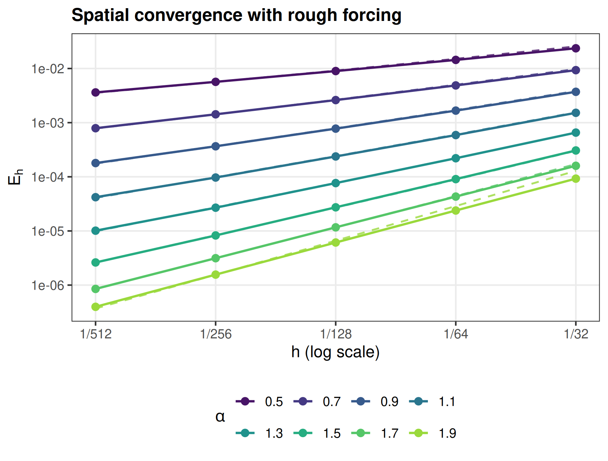
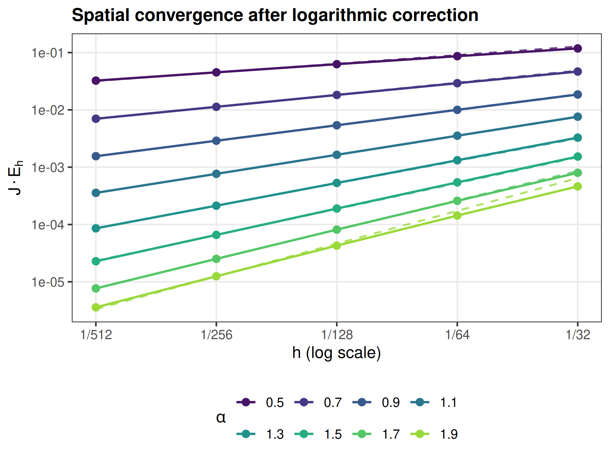

[Experiments](index.html) · [Theory and functions](brasilfunc.html)

Knit displays the saved results. To run a new experiment, edit the **Parameters
for the next run** chunk, then run the setup, parameters, and recompute chunks
manually in that order. The computation loops, error calculations, plotting,
and saving steps are written directly below. The recompute chunk overwrites the saved results and
figures. Knit again to display them. Parameter and recompute chunks are skipped
when knitting; the displayed settings always describe the saved results.

```{r setup, include=FALSE}
knitr::opts_chunk$set(message = FALSE, warning = FALSE, error = FALSE,
  echo = TRUE, cache = FALSE, fig.align = "center", dpi = 150)
helper <- tempfile(fileext = ".R")
knitr::purl("brasilfunc.Rmd", output = helper, quiet = TRUE)
sys.source(helper, envir = environment())
unlink(helper)
rough_result <- readRDS("data_files/rough_h_results.rds")
p <- rough_result$parameters
```

# Problem and exact solution

On the tadpole graph with stem length $1$ and loop length $2$, let
$L=\kappa^2-\Delta_\Gamma$ and consider
$$
\partial_tu+\nu L^{\alpha/2}u=g,\qquad u(0)=0,
\qquad T=`r p$T_final`,\quad\nu=`r p$diffusion`,\quad\kappa=`r p$kappa`.
$$
Use the same forcing for every $\alpha$:
$$
g=\sum_{j=1}^{\infty}\frac1j\phi_j,
\qquad
\phi_j(s)=
\begin{cases}
0,&s\text{ on the stem},\\
\sin(2^j\pi x),&s=x\in[0,2]\text{ on the loop}.
\end{cases}
$$
These orthonormal Kirchhoff eigenfunctions have eigenvalues
$\mu_j=\kappa^2+\pi^2 2^{2j}$. The series defines an $L_2(\Gamma)$ forcing:
$\|g\|_{L_2(\Gamma)}^2=\sum_{j\geq1}j^{-2}<\infty$.
For every $s>0$, $\sum_{j\geq1}\mu_j^s/j^2=\infty$, so $g$ has no positive
spectral Sobolev regularity. Writing $a_j=\nu\mu_j^{\alpha/2}$ gives the exact solution
$$
u(s,t)=\sum_{j=1}^{\infty}\frac{1-e^{-a_jt}}{j\,a_j}\phi_j(s).
$$

::: {.custom-box}
The spatial error estimate gives the term
$h^{\alpha-\epsilon}$ because $s_f=0$ and $u_0=0$ belongs to every spectral
Sobolev space. For this particular forcing on uniform P1 meshes
$h_J=2^{-J}$, the unresolved tail satisfies
$E_{\mathrm{tail}}\asymp h_J^\alpha/J$. This motivates the total-error model
$$
E_{h_J}:=\|u-U_{h_J,m}^{\tau}\|_{L_2(0,T;L_2(\Gamma))}
\approx C_\alpha\frac{h_J^\alpha}{J},\qquad0<\alpha<2,
$$
when temporal and rational errors are negligible and the finite-mode
contribution has the corresponding behavior. Under this model the raw
slope tends to $\alpha$; plotting $J E_{h_J}$ removes the leading
logarithmic factor. The tail estimate alone does not prove this model for
the total error. The derivation and its limitations are explained below.
:::

# Matrix discretization and error

The consistent P1 mass and stiffness matrices are assembled on the tadpole
with `MetricGraph`. Every backward Euler step advances the FEM coefficient
vector by shifted sparse matrix solves, using the same matrix update as
`cov_in_h_mat.Rmd`. The rational inverse is obtained from the positive
BRASIL coefficients in `rSPDE`, at the saved rational order listed below. The constant term of this
approximant is included in the update. The factorizations are reused across
all time steps.

The forcing is supported on the loop and has exact reflection symmetries.
The shifted FEM matrices are restricted to that invariant nodal subspace,
and the full graph solution is recovered by signed reflections. This is
the same FEM matrix evolution; no discrete eigenfunction recurrence is used.

The load is assembled by analytic sine–hat integrals. On a mesh $h_J=2^{-J}$,
the modes $j\geq J$ have zero $L_2$ projection onto $V_{h_J}$. They remain
part of the exact solution and its error. Their squared contribution is
$$
E_{\mathrm{tail}}^2=
\sum_{j=J}^{\infty}\frac1{j^2a_j^2}
\left[T-\frac{2(1-e^{-a_jT})}{a_j}
+\frac{1-e^{-2a_jT}}{2a_j}\right].
$$
The omitted remainder of this infinite sum is bounded by a geometric series
and is at most `r format(p$tail_tolerance,scientific=TRUE)` of its accumulated value. For the resolved modes,
the FEM mass norm, the spatial projection residual, and analytic time
integrals evaluate the error of the right-constant reconstruction on each
solver interval. Stable evaluation of the time integrals includes a
small-argument Gaussian approximation described in Step 11 below. No reference-mesh sampling or finite-mode replacement of $g$ is used.

# Step-by-step explanation of the error calculation

This section connects the fixed infinite forcing, the finite-element load,
the continuum error calculation, and Theorem `lastlasttheorem` in
`brasilmain.tex`. Write
$$
b_j(t)=\frac{1-e^{-a_jt}}{j a_j},\qquad
a_j=\nu(\kappa^2+\pi^2 2^{2j})^{\alpha/2},
\qquad u(t)=\sum_{j=1}^{\infty}b_j(t)\phi_j.
$$
All spatial inner products and norms below are on the full graph $\Gamma$.
The symmetry reduction changes the matrix size, while retaining this
full-graph norm.

## Step 1: Why this is a rough-data experiment

The functions $\phi_j$ are orthonormal. Consequently,
$$
\|g\|_{L_2}^2=\sum_{j=1}^{\infty}\frac{1}{j^2}<\infty.
$$
In a positive spectral Sobolev norm, however,
$$
\|g\|_{\dot H^s}^2
=\sum_{j=1}^{\infty}\frac{\mu_j^s}{j^2}=\infty,
\qquad s>0,
$$
because $\mu_j\asymp 2^{2j}$ and exponential growth dominates $j^2$.
Thus $g\in L_2=\dot H^0$, but $g$ belongs to no positive-order
spectral Sobolev space. The same infinite $g$ is used on every mesh and
for every $\alpha$; its regularity is not improved by refinement.

Each coefficient solves the scalar equation
$$
b_j'(t)+a_jb_j(t)=\frac1j,\qquad b_j(0)=0,
$$
which gives the explicit $b_j(t)$ above. This is an exact representation
of the continuum solution, even though it is an infinite series.

## Step 2: Why the infinite forcing has a finite, exact load vector

Fix the uniform mesh $h_J=2^{-J}$ and let $\psi_i$ be its P1 hat functions.
The load entry is
$$
F_i=(g,\psi_i)
=\sum_{j=1}^{\infty}\frac1j(\phi_j,\psi_i).
$$
For these frequencies and this aligned uniform mesh,
$$
(\phi_j,\psi_i)=0\qquad\text{for every }i\text{ and every }j\ge J.
$$
The integrals vanish by cancellation of the sine against the hats;
at the loop junction the two incident loop pieces are combined.
Therefore
$$
\boxed{F_i=\sum_{j=1}^{J-1}\frac1j(\phi_j,\psi_i).}
$$
Every remaining sine--hat integral has an analytic formula. A finite
calculation therefore gives the load for the original infinite forcing,
up to floating-point arithmetic. This is not the same as replacing the
continuum forcing by a truncated series.

For example, at a loop interior node $x_i$, with $k_j=2^j\pi$,
$$
(\phi_j,\psi_i)
=h_J\left(\frac{\sin(k_jh_J/2)}{k_jh_J/2}\right)^2\sin(k_jx_i).
$$
The code stores the retained sine--hat integrals in `mesh$B` and forms
`mesh$load` using the coefficients $1/j$.

## Step 3: What orthogonality means for the numerical solution

Every $v_h\in V_{h_J}$ is a linear combination of the hats, so
$$
(\phi_j,v_h)=0\qquad(j\ge J).
$$
In particular, the numerical solution has zero component in each of these
directions. This does not make those modes disappear from the true
solution: $b_j(t)>0$ for $t>0$.

More strongly, since $\|\phi_j\|_{L_2}=1$,
$$
\|b\phi_j-v_h\|_{L_2}^2=|b|^2+\|v_h\|_{L_2}^2,
\qquad j\ge J.
$$
Thus the best FEM approximation to that isolated mode is zero. Refining
the mesh moves the cutoff to higher frequencies. Modes below the cutoff
become accessible through nonzero projections, but the sines themselves
are still not piecewise linear and are not represented exactly.

## Step 4: Which error is being measured

The reported quantity is
$$
\boxed{
E=\|u-U_{h,m}^{\tau}\|_{L_2(0,T;L_2(\Gamma))}
=\left(\int_0^T\int_\Gamma
|u(s,t)-U_{h,m}^{\tau}(s,t)|^2\,ds\,dt\right)^{1/2}.
}
$$
The right-constant reconstruction is
$$
U_{h,m}^{\tau}(t)=U_{h,m}^{n},\qquad t\in(t_{n-1},t_n],
\quad t_n=n\tau.
$$
It is an error over the whole graph and time interval, not only an error
at mesh nodes or at the final time. For brevity write $U_h(t)$ for this
reconstruction in the following spatial decompositions.

Split the exact solution as
$$
u=u_{<J}+u_{\ge J},\qquad
u_{<J}=\sum_{j=1}^{J-1}b_j\phi_j,\qquad
u_{\ge J}=\sum_{j=J}^{\infty}b_j\phi_j.
$$
The tail starts at $j=J$, including that index. It is orthogonal both to
$u_{<J}$ and to $U_h$. Hence
$$
\boxed{
\|u(t)-U_h(t)\|_{L_2}^2
=\|u_{<J}(t)-U_h(t)\|_{L_2}^2
+\sum_{j=J}^{\infty}b_j(t)^2.
}
$$
It is the squared contributions that add; their square roots do not add
in this identity.

## Step 5: Computing the infinite-tail contribution without spatial sampling

Orthonormality gives the spatial norm directly from the coefficients.
Integrating in time, and interchanging the nonnegative sum and integral,
$$
E_{\mathrm{tail}}^2
=\sum_{j=J}^{\infty}\frac{1}{j^2a_j^2}
\int_0^T(1-e^{-a_jt})^2\,dt.
$$
Expanding the square and integrating the exponentials yields
$$
\boxed{
E_{\mathrm{tail}}^2
=\sum_{j=J}^{\infty}\frac{1}{j^2a_j^2}
\left[T-\frac{2(1-e^{-a_jT})}{a_j}
+\frac{1-e^{-2a_jT}}{2a_j}\right].
}
$$
No evaluation of the infinite solution at spatial points is required.
This is a positive scalar series with explicit terms.

## Step 6: Bounding the part of the tail sum that is not computed

Suppose we sum the terms from $j=J$ through $j=K$, obtaining $S_K$.
Write $E_{\mathrm{tail}}^2=S_K+R_K$, where $R_K\ge0$ is the uncomputed
remainder. Since $(1-e^{-a_jt})^2\le1$ and
$a_j\ge\nu\pi^\alpha 2^{\alpha j}$,
$$
R_K\le\frac{T}{\nu^2\pi^{2\alpha}}
\sum_{j=K+1}^{\infty}\frac{2^{-2\alpha j}}{j^2}.
$$
Using $j^{-2}\le(K+1)^{-2}$ and summing a geometric series gives
$$
\boxed{
R_K\le B_K:=
\frac{T}{\nu^2\pi^{2\alpha}(K+1)^2}
\frac{2^{-2\alpha(K+1)}}{1-2^{-2\alpha}}.
}
$$
Thus, in exact arithmetic,
$$
S_K\le E_{\mathrm{tail}}^2\le S_K+B_K.
$$
Both $S_K$ and $B_K$ can be computed. The routine `rough_tail()` keeps
adding terms until $B_K\le\eta S_K$, with the saved tolerance
$\eta=$ `r format(p$tail_tolerance, scientific=TRUE)`. At that point,
$$
0\le\frac{E_{\mathrm{tail}}^2-S_K}{S_K}\le\eta.
$$
Equivalently, $E_{\mathrm{tail}}^2\le S_K(1+\eta)$. The $1$ represents
the contribution already computed; only the extra $\eta S_K$ is omitted.
The tolerance is relative to the accumulated **squared tail error**.
The routine returns `squared`, `omitted_squared_bound`, and `last_j`.
This analytical remainder bound does not include floating-point roundoff
or certify the separate spatial quadrature.

## Step 7: Why split the finite part using an orthogonal projection?

We could directly apply elementwise quadrature to
$\|u_{<J}(t)-U_h(t)\|_{L_2}^2$. The additional split is a computational
choice that permits reuse of the spatial integrals and confines spatial
quadrature to one small matrix.

Let $P_h$ be the $L_2$-orthogonal projection onto $V_h$ and set
$p_h=P_hu_{<J}$. Then
$$
u_{<J}-U_h=(u_{<J}-p_h)+(p_h-U_h).
$$
The first term is orthogonal to $V_h$, while the second belongs to $V_h$.
Therefore
$$
\boxed{
\|u-U_h\|_{L_2}^2
=\|p_h-U_h\|_{L_2}^2
+\|u_{<J}-p_h\|_{L_2}^2
+\sum_{j=J}^{\infty}b_j^2.
}
$$
These are three orthogonal contributions to the same error. The
infinite-tail split accounts for unresolved frequencies; the projection
split organizes computation of the remaining finite part.

## Step 8: The consistent mass norm and projection-residual Gram matrix

Let $C_{i\ell}=(\psi_i,\psi_\ell)$ be the consistent mass matrix and
$B_{ij}=(\phi_j,\psi_i)$ for $1\le j<J$. The coefficient vector of
$P_h\phi_j$ is the $j$-th column of
$$
P=C^{-1}B.
$$
Thus $\mathbf p(t)=P\mathbf b(t)$, and
$$
\boxed{
\|p_h-U_h\|_{L_2}^2
=(P\mathbf b-\mathbf U)^\top C(P\mathbf b-\mathbf U).
}
$$
This quadratic form integrates the squared FEM function exactly in
space, up to arithmetic and linear-solve errors.

For the other term, define $r_j=\phi_j-P_h\phi_j$ and
$$
G_{jk}=(r_j,r_k).
$$
Then
$$
\boxed{
\|u_{<J}-p_h\|_{L_2}^2=\mathbf b^\top G\mathbf b.
}
$$
The residuals need not be mutually orthogonal, so we retain their cross
terms. The code calls this matrix `projection$residual_gram` and evaluates
its integrals element by element. It depends on the mesh and retained
modes, but not on time, so it is computed once for each mesh.

In exact arithmetic, orthogonality also gives $G=I-P^\top CP$.
Direct residual integration avoids obtaining a small residual by
subtracting two nearly equal quantities in that alternative formula.

## Step 9: How Gaussian quadrature behaves, and what is controlled

On an element $K$ of length $h$, the integrand for $G_{jk}$ is
$f=r_jr_k$. It is smooth within the element: each residual is a sine
minus an affine function on the loop, and an affine function on the stem.
The integral is approximated by a weighted sum of function values at
Gauss--Legendre nodes. A $q$-point rule is exact for polynomials of degree
at most $2q-1$; the saved $q=16$ rule is therefore exact through degree
$31$, but is not generally exact for the sine-containing integrands.

For $f\in C^{32}(K)$, its exact-arithmetic error satisfies
$$
\left|\int_K f(x)\,dx-Q_{16,K}(f)\right|
\le\frac{(16!)^4}{33(32!)^3}\,
h^{33}\max_{x\in K}|f^{(32)}(x)|.
$$
See the [NIST DLMF Gaussian remainder and Gauss--Legendre formula](https://dlmf.nist.gov/3.5#v).
The derivative factor matters: $h^{33}$ alone does not prove a small
error when the integrand oscillates rapidly. Here the highest retained
frequency satisfies
$$
2^j\pi h_J\le\frac{\pi}{2},\qquad j<J.
$$
Thus each retained sine changes phase by at most $\pi/2$ across one
element. The frequencies increase during refinement, but their
oscillation relative to an element stays bounded. This explains why
high-order elementwise quadrature is effective for this calculation.

A practical accuracy check is to hold the mesh, numerical solution, and
other parameters fixed, recompute $G$ using $32$ rather than $16$ points,
and compare the resulting reported errors. Agreement is evidence of
quadrature accuracy, not a rigorous remainder certificate. Such a check
is not performed by the recompute chunk below; no outcome of a
16-versus-32 comparison is asserted here.

For rigorous propagation, if $\widetilde G$ is the quadrature matrix,
$$
\left|\int_0^T\mathbf b(t)^\top
(\widetilde G-G)\mathbf b(t)\,dt\right|
\le\|\widetilde G-G\|_2
\int_0^T\|\mathbf b(t)\|_2^2\,dt.
$$
Entrywise derivative bounds can be summed over elements and converted
to a matrix-norm bound. The infinite-tail tolerance is a separate
control and does not supply this bound.

## Step 10: What "analytic time moments" means

Here "moments" refers to integrals of the coefficients and their
products, such as $\int b_j(t)\,dt$ and $\int b_j(t)b_k(t)\,dt$.
There is no probability distribution involved. "Analytic time
integrals" describes the mathematical calculation more directly.

For any interval $[\ell,r]$, define
$$
F_c(\ell,r)=\int_\ell^r e^{-ct}\,dt
=\frac{e^{-c\ell}-e^{-cr}}{c},\qquad c>0.
$$
Then
$$
\int_\ell^r b_j(t)\,dt
=\frac{(r-\ell)-F_{a_j}(\ell,r)}{j a_j},
$$
and
$$
\boxed{
\int_\ell^r b_j(t)b_k(t)\,dt
=\frac{(r-\ell)-F_{a_j}(\ell,r)-F_{a_k}(\ell,r)
+F_{a_j+a_k}(\ell,r)}{jk a_ja_k}.
}
$$
For example, setting $H_{jk}=\int_0^T b_j(t)b_k(t)\,dt$ gives
$$
\int_0^T\|u_{<J}-p_h\|_{L_2}^2\,dt
=\sum_{j,k=1}^{J-1}G_{jk}H_{jk}.
$$
The case $j=k$ gives the same scalar integral used in the tail sum.
These are exact mathematical formulas. Their floating-point evaluation
needs care when exponentials are close to one.

## Step 11: Integrating against the right-constant numerical solution

On $I_n=(t_{n-1},t_n]$, the numerical coefficient vector $\mathbf U^n$
is fixed. Direct expansion gives
$$
\begin{aligned}
\int_{I_n}\|p_h(t)-U_h^n\|_{L_2}^2\,dt
={}&\int_{I_n}\mathbf p(t)^\top C\mathbf p(t)\,dt\\
&-2(\mathbf U^n)^\top C\int_{I_n}\mathbf p(t)\,dt
+\tau(\mathbf U^n)^\top C\mathbf U^n.
\end{aligned}
$$
Since $\mathbf p=P\mathbf b$, all the needed integrals are the
coefficient and product integrals above. No reference time grid is needed.

The implementation uses an equivalent mean-and-variance identity that
avoids cancellation between large nearly equal terms. Define
$$
\overline b_j^{\,n}=\frac1\tau\int_{I_n}b_j(t)\,dt,\qquad
v_j^n=\frac1\tau\int_{I_n}(b_j(t)-\overline b_j^{\,n})^2\,dt.
$$
The interval-average continuum solution is
$\overline u_{<J}^{\,n}=\sum_{j<J}\overline b_j^{\,n}\phi_j$.
The time integral of $u_{<J}-\overline u_{<J}^{\,n}$ is zero, so the
cross term with the time-constant function
$\overline u_{<J}^{\,n}-U_h^n$ vanishes. Orthonormality of the $\phi_j$
then gives
$$
\boxed{
\begin{aligned}
\int_{I_n}\|u_{<J}(t)-U_h^n\|_{L_2}^2\,dt
=\tau\big[&
(P\overline{\mathbf b}^{\,n}-\mathbf U^n)^\top
C(P\overline{\mathbf b}^{\,n}-\mathbf U^n)\\
&+(\overline{\mathbf b}^{\,n})^\top G\overline{\mathbf b}^{\,n}
+\sum_{j=1}^{J-1}v_j^n\big].
\end{aligned}
}
$$
The variance term accounts for the exact solution varying during the
interval, even though $U_h^n$ is held fixed. This is the identity used in
`rough_matrix_evolve_cpp()`.

For clarity, with $A_j=1/(j a_j)$, $d_j=e^{-a_jt_{n-1}}$, and
$z_j=a_j\tau$, the mean and variance are
$$
\overline b_j^{\,n}
=A_j\left[1-d_j\frac{1-e^{-z_j}}{z_j}\right],
$$
$$
v_j^n=A_j^2d_j^2
\left[\frac{1-e^{-2z_j}}{2z_j}
-\left(\frac{1-e^{-z_j}}{z_j}\right)^2\right].
$$
The code uses `expm1` and short series to evaluate small differences
stably. One implementation detail qualifies the phrase "exact time
integrals": for $z_j<0.05$, `exponential_variance()` evaluates the
centered exponential variance using an 8-point Gaussian rule on the
normalized interval. The mathematical target is the explicit variance
above, but this branch is a high-order numerical approximation, not
symbolically exact integration. It is separate from the 16-point
spatial quadrature and from backward Euler's time-discretization error.
No numerical accuracy certificate for this branch is claimed here.

The solver sums the interval contributions with compensated summation,
adds the computed $E_{\mathrm{tail}}^2$, and takes the square root.
In the returned object, `resolved_squared` is the finite-mode
space--time contribution and `tail_squared` is the accumulated tail sum.

## Step 12: How this is related to the theorem's error

For $0<\alpha<2$, Theorem `lastlasttheorem` bounds
$$
\|u-U_{h,m}^{\tau}\|_{L_2(0,T;L_2(\Gamma))}
\lesssim\tau+
h^{\min\{s_0+\alpha/2,\ s_f+\alpha,\ 2\}-\epsilon}
+\delta_m.
$$
Here $u_0=0$ permits arbitrarily large $s_0$, while the forcing only
permits $s_f=0$. Thus, for sufficiently small $\epsilon>0$,
$$
\boxed{E\lesssim\tau+h^{\alpha-\epsilon}+\delta_m.}
$$
The theorem's rational-approximation assumptions give the stated
root-exponential bound on $\delta_m$. A fixed positive diffusion
coefficient $\nu$ changes constants, while preserving these orders.
The theorem treats $\alpha=2$ separately, with the exact rational
representation and the bound $\tau+h^2$; this study uses $0<\alpha<2$.

The computed quantity targets exactly the norm on the theorem's
left-hand side. The mass/projection/tail split is a way of evaluating
that norm. It is not a term-by-term identification with the theorem's
temporal/spatial/rational upper bounds. In particular, the mass-norm
part can contain effects from all three discretization choices.
Quadrature, tail-summation, linear-solve, and arithmetic errors in
evaluating or computing the solution require their own accuracy checks.

The spatial experiment keeps $\tau$ and $m$ fixed along each mesh curve
and selects them to limit their influence over the tested range. Under
further refinement, fixed temporal or rational errors can eventually
mask spatial convergence. The temporal study instead holds the spatial
and rational settings fixed and checks first-order convergence in
$\tau$. These experiments provide numerical evidence for the theorem's
orders; a finite set of slopes is not a proof of its bound.

## Step 13: Why this forcing suggests the factor $1/J$

For fixed $T>0$, $\nu>0$, and $\alpha>0$, the bracket in the tail formula
tends to $T$ as $j\to\infty$, and $a_j\asymp2^{\alpha j}$. Hence
$$
E_{\mathrm{tail}}^2\asymp
\sum_{j=J}^{\infty}\frac{2^{-2\alpha j}}{j^2}.
$$
This sum is bounded below by its first term and above by
$2^{-2\alpha J}/[J^2(1-2^{-2\alpha})]$. Therefore
$$
\boxed{E_{\mathrm{tail}}\asymp\frac{2^{-\alpha J}}{J}
=\frac{h_J^\alpha}{\log_2(1/h_J)}.}
$$
The factor $h_J^\alpha$ comes from damping the high frequencies; $1/J$
comes from the forcing amplitudes $1/j$. Since the tail is an orthogonal
error contribution, $E\ge E_{\mathrm{tail}}$. This establishes a lower
bound for the total error and motivates the model
$E_{h_J}\approx C_\alpha h_J^\alpha/J$. The tail calculation alone does
not prove a matching upper bound for the other contributions or show
that a tested mesh range has reached this regime.

The model is compatible with the theorem because
$$
\frac{h_J^\alpha/J}{h_J^{\alpha-\epsilon}}
=\frac{h_J^\epsilon}{J}\longrightarrow0.
$$
An upper bound permits the actual error to decay faster. At the same
time, for every $\eta>0$,
$$
\frac{h_J^\alpha/J}{h_J^{\alpha+\eta}}
=\frac{h_J^{-\eta}}{J}\longrightarrow\infty.
$$
Thus the tail rules out a higher algebraic order $\alpha+\eta$ for this
fixed forcing, while permitting the logarithmic improvement.

## Step 14: Why report raw and logarithmically corrected slopes?

Under the model $E_{h_J}\approx C_\alpha h_J^\alpha/J$, halving the mesh
gives
$$
\frac{E_{h_J}}{E_{h_{J+1}}}\approx
2^\alpha\frac{J+1}{J}.
$$
The two-mesh observed order is therefore
$$
\log_2\frac{E_{h_J}}{E_{h_{J+1}}}
\approx\alpha+\log_2\left(\frac{J+1}{J}\right)>\alpha.
$$
The raw slope can exceed $\alpha$ even when this model holds exactly.
Multiplying by $J$ gives $J E_{h_J}\approx C_\alpha h_J^\alpha$, which
motivates the corrected regression below. This correction removes a
factor associated with the particular forcing; the theorem does not
assert a universal $1/J$ factor for all $L_2$ data.

Lower modes are smooth and can contribute a second-order spatial term.
Comparing that scale with the tail gives the ratio
$$
\frac{h_J^2}{h_J^\alpha/J}=J h_J^{2-\alpha}.
$$
For fixed $\alpha<2$ it eventually tends to zero, but the separation
can be slow when $\alpha$ is close to $2$. This is consistent with a
remaining lower-mode contribution over a finite mesh range; it does
not establish the cause of a particular observed slope. Corrected
slopes near $\alpha$, together with sufficiently small other errors,
support the theorem's regularity-dependent spatial order.


# Parameters for the next run

```{r parameters, eval=FALSE}
alpha_vector <- seq(0.5,1.9,0.2)
T_final <- 1
kappa <- 4
J_vector <- 5:9
time_steps <- c(5e-4,1.25e-4,1/30000,1e-5,1/320000,1e-6,4e-7,2e-7)
m_fixed <- 14L
diffusion <- 1
fit_J <- 7:9
symmetry_reduction <- TRUE
projection_quadrature <- 16L
tail_tolerance <- 1e-13
workers <- 1L
```

```{r recompute, eval=FALSE}
# Saved files overwritten by this computation.
output_file <- "data_files/rough_h_results.rds"
output_dir <- "data_files/rough"
root <- getwd()
cache_dir <- tempdir()
checkpoint_dir <- tempfile("rough-h-checkpoints-")

parameters <- list(alpha=alpha_vector,J=J_vector,T_final=T_final,
  kappa=kappa,diffusion=diffusion,projection_quadrature=projection_quadrature,
  tail_tolerance=tail_tolerance,time_steps=time_steps,rational_order=m_fixed,
  fit_J=fit_J,symmetry_reduction=symmetry_reduction,
  forcing="sum_{j>=1} sin(2^j*pi*x)/j on loop; zero on stem",
  reconstruction="right-constant backward Euler",
  error_integration="analytic time moments, spatial projection residual, bounded infinite tail")

# Execute the refinement study and compute regression rates.
stopifnot(length(parameters$alpha) == length(parameters$time_steps), all(parameters$fit_J %in% parameters$J),
    workers >= 1L, workers == as.integer(workers))
dir.create(checkpoint_dir, recursive = TRUE, showWarnings = FALSE)
dir.create(dirname(output_file), recursive = TRUE, showWarnings = FALSE)
rough_compile_solver(root, cache_dir)
cases <- expand.grid(J = parameters$J, alpha_index = seq_along(parameters$alpha))
case_provenance <- list(parameters = parameters, sources = tools::md5sum(file.path(root, "brasilfunc.Rmd")))
# Each case assembles its mesh and applies the matrix time-step solver.
run_case <- function(i) {
    J <- cases$J[i]
    a <- cases$alpha_index[i]
    alpha <- parameters$alpha[a]
    checkpoint <- file.path(checkpoint_dir, sprintf("J%02d-alpha%03d.rds", J, round(100 * alpha)))
    if (file.exists(checkpoint)) {
        saved <- readRDS(checkpoint)
        if (!identical(saved$identity, case_provenance))
            stop("Checkpoint source/settings mismatch: ", checkpoint)
        return(saved$value)
    }
    message(sprintf("Matrix experiment: J=%s, h=%g, alpha=%g", J, 2^-J, alpha))
    mesh <- rough_mesh(J, parameters$kappa)
    projection <- rough_projection(mesh, parameters$projection_quadrature)
    value <- rough_solve(mesh, alpha, parameters$time_steps[a], order = parameters$rational_order,
        diffusion = parameters$diffusion, T_final = parameters$T_final, projection = projection,
        tail_tolerance = parameters$tail_tolerance, symmetry_reduction = parameters$symmetry_reduction)
    value$final_state <- value$states <- NULL
    value$J <- J
    value$alpha <- alpha
    value$n_nodes <- nrow(mesh$C)
    saveRDS(list(identity = case_provenance, value = value), checkpoint)
    message(sprintf("Finished J=%s alpha=%g: E=%.9g (%.2f s)", J, alpha, value$error, value$elapsed))
    value
}
safe_case <- function(i) tryCatch(run_case(i), error = function(e) list(failed = TRUE, message = conditionMessage(e),
    case = i))
values <- if (workers > 1L && .Platform$OS.type == "unix")
    parallel::mclapply(seq_len(nrow(cases)), safe_case, mc.cores = min(workers, nrow(cases)), mc.preschedule = FALSE) else lapply(seq_len(nrow(cases)), safe_case)
failed <- vapply(values, function(x) !is.list(x) || isTRUE(x$failed), logical(1))
if (any(failed))
    stop("Rough experiment failed: ", paste(vapply(values[failed], function(x) if (is.list(x))
        x$message else as.character(x), character(1)), collapse = "; "))
errors <- matrix(vapply(values, `[[`, numeric(1), "error"), nrow = length(parameters$J), ncol = length(parameters$alpha))
corrected <- errors * parameters$J
fit <- which(parameters$J %in% parameters$fit_J)
slope <- function(y) unname(coef(stats::lm(log10(y[fit]) ~ log10(2^-parameters$J[fit])))[2L])
rates <- data.frame(alpha = parameters$alpha, theoretical = parameters$alpha, raw = apply(errors,
    2L, slope), corrected = apply(corrected, 2L, slope))
rates$relative_error_percent <- 100 * abs(rates$corrected - rates$alpha)/rates$alpha
result <- list(parameters = parameters, errors = errors, corrected_errors = corrected, rates = rates,
    cases = values, provenance = case_provenance, generated_at = format(Sys.time(), "%Y-%m-%d %H:%M:%S %Z",
        tz = "Asia/Riyadh"), session_info = utils::sessionInfo())
saveRDS(result, output_file)
rough_result <- result

# Draw reference guides and overwrite the saved figures.
dir.create(output_dir,recursive=TRUE,showWarnings=FALSE)
for(corrected in c(FALSE,TRUE)) {
  p <- result$parameters
  errors <- if (corrected)
      result$corrected_errors else result$errors
  frame <- expand.grid(J = p$J, column = seq_along(p$alpha))
  frame$h <- 2^-frame$J
  frame$error <- as.vector(errors)
  frame$alpha <- factor(p$alpha[frame$column], levels = p$alpha)
  fit <- which(p$J %in% p$fit_J)
  guide <- frame
  for (a in seq_along(p$alpha)) {
      target <- guide$column == a
      model <- (2^-p$J)^p$alpha[a]
      if (!corrected)
          model <- model/p$J
      constant <- exp(mean(log(errors[fit, a]/model[fit])))
      guide$error[target] <- constant * model
  }
  label <- if (corrected)
      expression(J %.% E[h]) else expression(E[h])
  plot <- ggplot2::ggplot(frame, ggplot2::aes(h, error, color = alpha, group = alpha)) + ggplot2::geom_line(data = guide,
      linetype = "dashed", linewidth = 0.65, alpha = 0.8) + ggplot2::geom_line(linewidth = 0.8) + ggplot2::geom_point(size = 2.2) +
      ggplot2::scale_x_log10(breaks = 2^-p$J, labels = function(x) paste0("1/", round(1/x))) + ggplot2::scale_y_log10() +
      ggplot2::scale_color_viridis_d(option = "D", begin = 0.05, end = 0.85) + ggplot2::guides(color = ggplot2::guide_legend(nrow = 2L,
      byrow = TRUE)) + ggplot2::labs(x = expression(h ~ "(log scale)"), y = label, color = expression(alpha),
      title = if (corrected)
          "Spatial convergence after logarithmic correction" else "Spatial convergence with rough forcing") + ggplot2::theme_bw(base_size = 12) + ggplot2::theme(legend.position = "bottom",
      panel.grid.minor = ggplot2::element_blank(), plot.title = ggplot2::element_text(size = 13, face = "bold"))
  name <- if(corrected) "conv_h_rough_corrected" else "conv_h_rough_raw"
  for(extension in c("png","pdf")) ggplot2::ggsave(
    file.path(output_dir,paste0(name,".",extension)),plot,
    width=6.2,height=4.7,dpi=300,bg="white")
}
```

# Saved parameters

```{r load-results, include=FALSE}
rough_result <- readRDS("data_files/rough_h_results.rds")
p <- rough_result$parameters
```

```{r saved-common-parameters, echo=FALSE}
knitr::kable(data.frame(T=p$T_final,kappa=p$kappa,diffusion=p$diffusion))
```


The time step and rational order are fixed along each spatial refinement
curve. The final settings are:

```{r settings, echo=FALSE}
knitr::kable(data.frame(
  alpha = p$alpha, tau = format(p$time_steps, scientific = TRUE),
  m = p$rational_order, meshes = paste0("1/",2^p$J,collapse=", ")),
  col.names = c("$\\alpha$", "$\\tau$", "$m$", "$h$"),
  align = c("r", "r", "r", "l"))
```

# Results

The solid curves show the computed matrix-solver errors. Dashed curves in
the first figure follow $C_\alpha h^\alpha/J$; dashed curves in the second
follow $C_\alpha h^\alpha$. Their constants are fitted over the saved fit meshes, $J \in$ `r paste(p$fit_J,collapse=", ")`.

```{r raw-error, echo=FALSE, out.width="650px", fig.cap="Spatial error for the fixed rough forcing. Dashed curves follow h^alpha/J; solid curves and markers are the matrix-solver results."}

```

```{r corrected-error, echo=FALSE, out.width="650px", fig.cap="Logarithmically corrected error J E_h, where J=log_2(1/h). Dashed lines have slope alpha."}

```

```{r rates, echo=FALSE}
rates <- rough_result$rates
knitr::kable(rates, digits = c(1, 1, 4, 4, 2),
  col.names = c("$\\alpha$", "Reference", "Raw slope", "Corrected slope",
                "Corrected relative error (%)"),
  caption = "Regression slopes over the saved fit meshes.")
```

The logarithmic correction accounts for the factor $1/J$ in the error
model. The remaining differences from $\alpha$ reflect the finite
refinement range: $J E_h\sim C_\alpha h^\alpha$ is an asymptotic statement.
For $\alpha$ close to $2$, the second-order contribution from low modes
can remain significant over this mesh range, so the limiting corrected
slope can take longer to appear.

```{r errors, echo=FALSE, results='asis'}
errors <- data.frame(h = paste0("1/", 2^p$J),
  apply(rough_result$errors, 2L, function(x) formatC(x, format = "e", digits = 6)))
names(errors) <- c("$h$", paste0("$\\alpha=", p$alpha, "$"))
cat('<div style="overflow-x:auto">\n',
  knitr::kable(errors, format = "html", caption = "Computed space–time errors.",
    table.attr = 'class="table table-condensed" style="font-size:13px; white-space:nowrap"'),
  '\n</div>\n')
```
