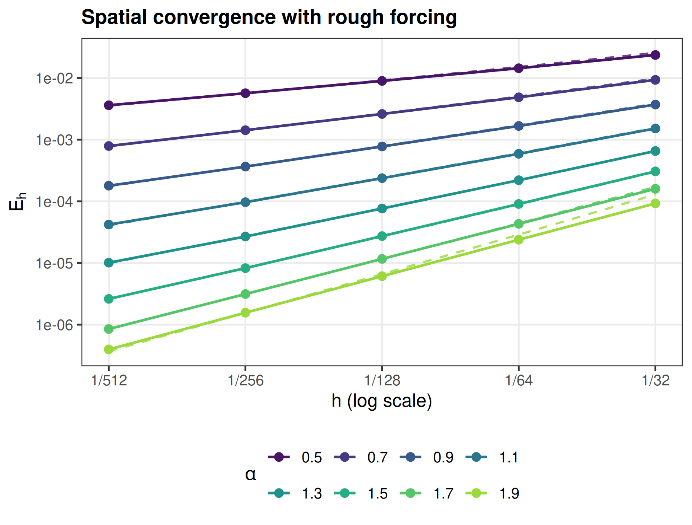
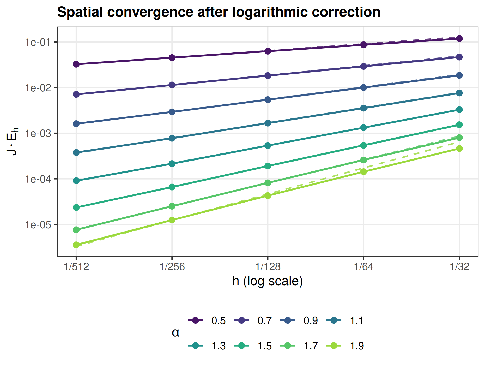

Go back to the [Contents](about.html) page.

```{r setup, include=FALSE}
knitr::opts_chunk$set(message = FALSE, warning = FALSE, error = FALSE,
  echo = TRUE, cache = FALSE, fig.align = "center", dpi = 150)
source("fun/rough/load.R")
rough_result <- readRDS("data_files/rough_h_results.rds")
stopifnot(identical(rough_result$parameters, rough_parameters()))
p <- rough_result$parameters
```

# Problem and exact solution

On the tadpole graph with stem length $1$ and loop length $2$, let
$L=\kappa^2-\Delta_\Gamma$ and consider
$$
\partial_tu+\nu L^{\alpha/2}u=g,\qquad u(0)=0,
\qquad T=1,\quad\nu=1,\quad\kappa=4.
$$
Use the same forcing for every $\alpha$:
$$
g=\sum_{j=1}^{\infty}\frac1j\phi_j,
\qquad
\phi_j(s)=
\begin{cases}
0,&s\text{ on the stem},\\
\sin(2^j\pi x),&s=x\in[0,2]\text{ on the loop}.
\end{cases}
$$
These orthonormal Kirchhoff eigenfunctions have eigenvalues
$\mu_j=\kappa^2+\pi^2 2^{2j}$. The series defines an $L_2(\Gamma)$ forcing:
$\|g\|_{L_2(\Gamma)}^2=\sum_{j\geq1}j^{-2}<\infty$.
For every $s>0$, $\sum_{j\geq1}\mu_j^s/j^2=\infty$, so $g$ has no positive
spectral Sobolev regularity. Writing $a_j=\nu\mu_j^{\alpha/2}$ gives the exact solution
$$
u(s,t)=\sum_{j=1}^{\infty}\frac{1-e^{-a_jt}}{j\,a_j}\phi_j(s).
$$

::: {.custom-box}
Theorem `lastlasttheorem` in `main.tex` gives the spatial term
$h^{\alpha-\epsilon}$ because $s_f=0$ and $u_0=0$ belongs to every spectral
Sobolev space. For this particular forcing, uniform P1 meshes with
$h_J=2^{-J}$ give the sharper asymptotic behavior
$$
E_{h_J}:=\|u-U_{h_J,m}^{\tau}\|_{L_2(0,T;L_2(\Gamma))}
\asymp\frac{h_J^\alpha}{J},\qquad0<\alpha<2,
$$
when temporal and rational errors are negligible. Thus the raw slope tends
to $\alpha$; plotting $J E_{h_J}$ removes the leading logarithmic factor.
:::

# Matrix discretization and error

The consistent P1 mass and stiffness matrices are assembled on the tadpole
with `MetricGraph`. Every backward Euler step advances the FEM coefficient
vector by shifted sparse matrix solves, using the same matrix update as
`cov_in_h_mat.Rmd`. The rational inverse uses the operator-based root/factor
representation with order $m=8$. Coefficients are read directly at
$\beta=\alpha/2$ from `matlab/computed_fractional_roots.csv`; no
interpolation in $\beta$ is used. These locally generated Cheb–Padé
coefficients are distinct from the installed `rSPDE` tables. The
degree-$m$ numerator and degree-$(m+1)$ denominator give $m+1$ shifted
solves and no constant term in the update. Factorizations are reused.

This branch retains the same meshes, diffusion, and time steps as the
BRASIL baseline. The [coefficient comparison](rough_operator_comparison.html)
also reports order $m=4$ and preserves the original BRASIL results.

The forcing is supported on the loop and has exact reflection symmetries.
The shifted FEM matrices are restricted to that invariant nodal subspace,
and the full graph solution is recovered by signed reflections. This is
the same FEM matrix evolution; no discrete eigenfunction recurrence is used.

The load is assembled by analytic sine–hat integrals. On a mesh $h_J=2^{-J}$,
the modes $j\geq J$ have zero $L_2$ projection onto $V_{h_J}$. They remain
part of the exact solution and its error. Their squared contribution is
$$
E_{\mathrm{tail}}^2=
\sum_{j=J}^{\infty}\frac1{j^2a_j^2}
\left[T-\frac{2(1-e^{-a_jT})}{a_j}
+\frac{1-e^{-2a_jT}}{2a_j}\right].
$$
The omitted remainder of this infinite sum is bounded by a geometric series
and is at most $10^{-13}$ of its accumulated value. For the resolved modes,
the FEM mass norm, the spatial projection residual, and exact time moments
evaluate the error of the right-constant reconstruction on each solver
interval. No reference-mesh sampling or finite-mode replacement of $g$ is used.

```{r parameters}
J_vector <- p$J
h_vector <- 2^-J_vector
alpha_vector <- seq(0.5, 1.9, 0.2)
stopifnot(isTRUE(all.equal(alpha_vector, p$alpha)))
m_fixed <- p$rational_order
time_steps <- p$time_steps
T_final <- p$T_final
diffusion <- p$diffusion
kappa <- p$kappa
```

The time step and rational order are fixed along each spatial refinement
curve. The final settings are:

```{r settings, echo=FALSE}
knitr::kable(data.frame(
  alpha = p$alpha, tau = format(p$time_steps, scientific = TRUE),
  m = p$rational_order, meshes = "1/32, 1/64, 1/128, 1/256, 1/512"),
  col.names = c("$\\alpha$", "$\\tau$", "$m$", "$h$"),
  align = c("r", "r", "r", "l"))
```

# Results

The solid curves show the computed matrix-solver errors. Dashed curves in
the first figure follow $C_\alpha h^\alpha/J$; dashed curves in the second
follow $C_\alpha h^\alpha$. Their constants are fitted over the three finest
meshes, $h=1/128,1/256,1/512$.

```{r raw-error, echo=FALSE, out.width="650px", fig.cap="Spatial error for the fixed rough forcing. Dashed curves follow h^alpha/J; solid curves and markers are the matrix-solver results."}

```

```{r corrected-error, echo=FALSE, out.width="650px", fig.cap="Logarithmically corrected error J E_h, where J=log_2(1/h). Dashed lines have slope alpha."}

```

```{r rates, echo=FALSE}
rates <- rough_result$rates
knitr::kable(rates, digits = c(1, 1, 4, 4, 2),
  col.names = c("$\\alpha$", "Reference", "Raw slope", "Corrected slope",
                "Corrected relative error (%)"),
  caption = "Regression slopes over the three finest meshes.")
```

The logarithmic correction accounts for the factor $1/J$ in the ideal
spatial error model. The measured error also contains the fixed-order
rational approximation error. If that contribution dominates, multiplying
by $J$ cannot restore the ideal spatial slope. The matched coefficient
comparison separates that effect from the finite spatial refinement range.
For $\alpha$ close to $2$, the second-order contribution from low modes
can remain significant over this mesh range, so the limiting corrected
slope can take longer to appear.

```{r errors, echo=FALSE, results='asis'}
errors <- data.frame(h = paste0("1/", 2^p$J),
  apply(rough_result$errors, 2L, function(x) formatC(x, format = "e", digits = 6)))
names(errors) <- c("$h$", paste0("$\\alpha=", p$alpha, "$"))
cat('<div style="overflow-x:auto">\n',
  knitr::kable(errors, format = "html", caption = "Computed space–time errors.",
    table.attr = 'class="table table-condensed" style="font-size:13px; white-space:nowrap"'),
  '\n</div>\n')
```
