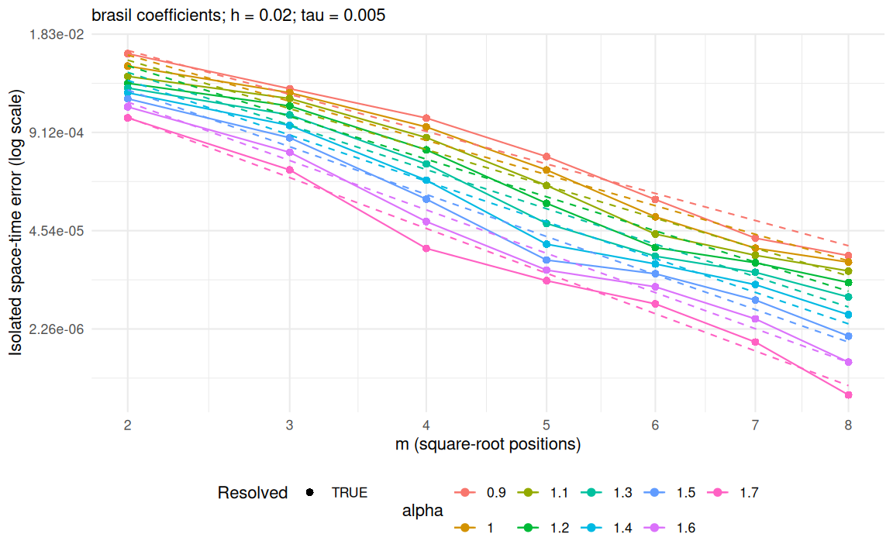
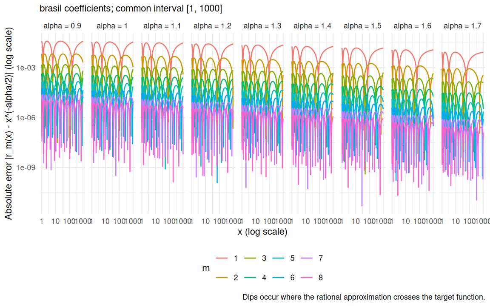
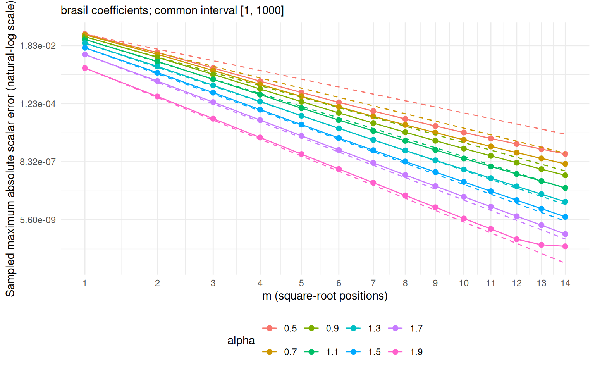
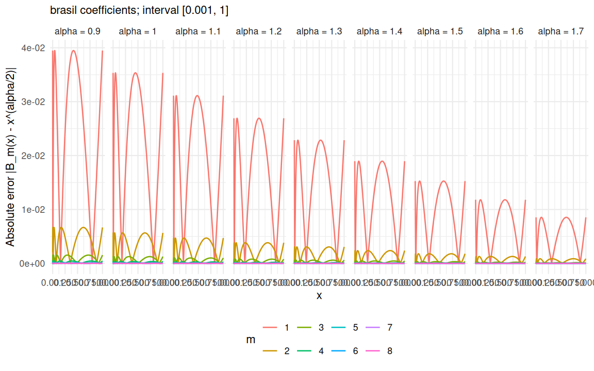
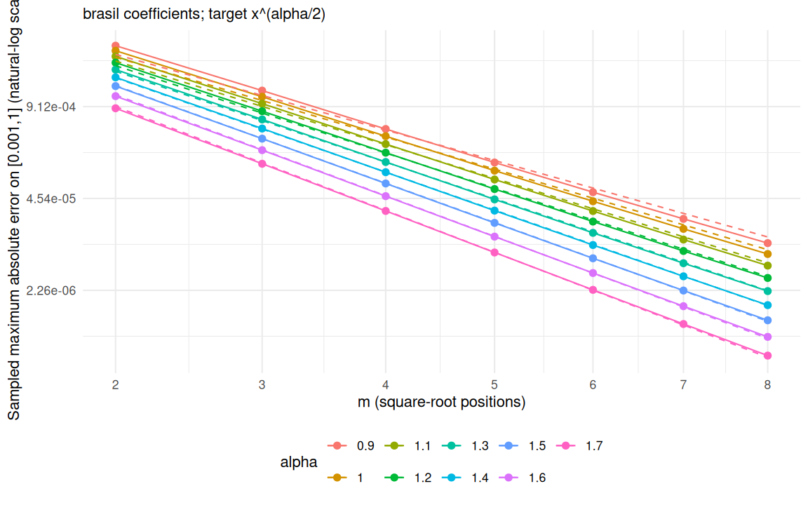
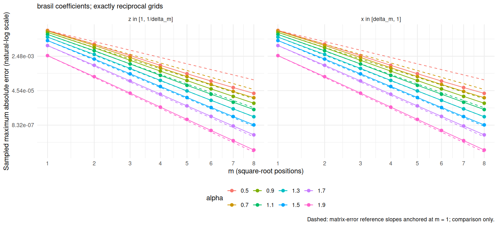

[Experiments](index.html) · [Theory and functions](brasilfunc.html)

Knit displays the saved results. To run a new experiment, edit the **Parameters
for the next run** chunk, then run the setup, parameters, and recompute chunks
manually in that order. The recompute chunk overwrites the saved results and
figures. Knit again to display them. Parameter and recompute chunks are skipped
when knitting; the displayed settings always describe the saved results.

```{r setup, include=FALSE}
knitr::opts_chunk$set(message=FALSE,warning=FALSE,error=FALSE,cache=FALSE)
helper <- tempfile(fileext = ".R")
knitr::purl("brasilfunc.Rmd", output = helper, quiet = TRUE)
sys.source(helper, envir = environment())
unlink(helper)
r <- readRDS("data_files/isolated_m_results.rds")

```

## Parameters for the next run

```{r parameters, eval=FALSE}
h <- 0.02
tau <- 0.005
m_max <- 14L
alpha_vector <- seq(0.5,1.9,0.2)
T_final <- 1
kappa <- 4
diffusion <- 1
initial_amplitude <- 10
forcing_amplitude <- 10
AAA <- 1
OMEGA <- pi
```

```{r recompute, eval=FALSE}
r <- run_isolated_brasil(h=h,tau=tau,m_max=m_max,alpha_vector=alpha_vector,
  T_final=T_final,kappa=kappa,diffusion=diffusion,
  initial_amplitude=initial_amplitude,forcing_amplitude=forcing_amplitude,
  AAA=AAA,OMEGA=OMEGA,output_file="data_files/isolated_m_results.rds",
  figure_dir="data_files/isolated_m")
```

## Saved parameters

```{r load-results, include=FALSE}
r <- readRDS("data_files/isolated_m_results.rds")
```

```{r saved-parameters, echo=FALSE}
p <- r$parameters
knitr::kable(data.frame(h=p$h,tau=p$tau,m_max=p$m_max,T=p$T_final,
  kappa=p$kappa,diffusion=p$diffusion))
knitr::kable(data.frame(alpha=p$alpha_vector))
# Original saved runs used these amplitudes and sine settings.
# New runs record the values explicitly in their metadata.
a0 <- if(is.null(p$initial_amplitude)) 10 else p$initial_amplitude
af <- if(is.null(p$forcing_amplitude)) 10 else p$forcing_amplitude
A <- if(is.null(p$AAA)) 1 else p$AAA
omega <- if(is.null(p$OMEGA)) pi else p$OMEGA
knitr::kable(data.frame(initial_amplitude=a0,forcing_amplitude=af,AAA=A,OMEGA=omega))
```

## Matrix experiment

The smooth data are $u_0=a_0e_5$ and $f(t)=a_f A\sin(\omega t)e_7$ on the
length-(1,2) tadpole. Both evolutions use the **same assembled consistent P1
FEM matrices**, analytic loads, and interval-averaged forcing.
For $LV=CV\Lambda$ with $V^\top CV=I$, the reference is
$$
U_h^{k+1}=V\operatorname{diag}\!\left(
  \frac{1}{1+\tau\nu\lambda_j^{\alpha/2}}\right)
  V^\top(CU_h^k+\tau F^{k+1}).
$$
The rational evolution applies shifted sparse solves with installed `rSPDE`
BRASIL coefficients and retains the mass solve from the constant term.
The numerical eigenbasis supplies an independent reference and diagnostic;
it does not replace the rational matrix solver. The isolated error is
$$
E_m^2=\tau\sum_{k=1}^N
 (U_h^k-U_{h,m}^k)^\top C(U_h^k-U_{h,m}^k).
$$
All orders use the same mesh and time grid. Dense eigendecomposition is
restricted to moderate meshes. For $\alpha=2$, ordinary backward Euler
provides a control without rational approximation.

## Saved matrix results

```{r errors, echo=FALSE}
knitr::kable(r$errors,format.args=list(scientific=TRUE,digits=5))
```

```{r matrix-figure, echo=FALSE, out.width="750px"}

```

Dashed lines have benchmark exponent $-2\pi\sqrt{\alpha/2}$ against
$\sqrt m$, anchored at the first order. Open circles are below an empirical
numerical-resolution indicator and are excluded from resolved-only fits.
These are reference slopes, not certified error bounds.

```{r slopes, echo=FALSE}
knitr::kable(r$slopes,digits=5)
```

## Numerical checks

The independent evolution evaluates the supplied inverse approximation
directly in the complete numerical eigenbasis, including its constant.
Its agreement with the sparse evolution checks the matrix implementation.
The resolution indicator is the larger of that disagreement and the
classical backward Euler control error.

```{r diagnostics, echo=FALSE}
knitr::kable(r$diagnostics,digits=10)
knitr::kable(r$control[,c("error","product_error","final_state_gap_C")],
  format.args=list(scientific=TRUE,digits=5))
knitr::kable(r$results[,c("alpha","m","error","product_error",
  "absolute_error_disagreement","resolved")],
  format.args=list(scientific=TRUE,digits=5))
```

## Scalar approximation diagnostics

Writing $\beta=\alpha/2$, the same installed coefficients define
$$
S_m(y)=d_m+\sum_{j=1}^m\frac{\rho_j}{y-\eta_j}
\approx y^{-\beta},\qquad B_m(x)=S_m(1/x)\approx x^\beta.
$$
The following saved plots show absolute scalar errors on $[1,1000]$ and
$[0.001,1]$, followed by their sampled maxima versus $\sqrt m$.
The two grids are reciprocal, so the errors agree up to rounding.
Sampled maxima are not certified uniform bounds.

```{r scalar-error-curves, echo=FALSE, out.width="850px", fig.cap="Inverse-power errors on [1,1000]."}

```

```{r scalar-error-convergence, echo=FALSE, out.width="850px", fig.cap="Sampled maximum inverse-power errors."}

```

```{r unit-interval-error-curves, echo=FALSE, out.width="850px", fig.cap="Direct-power errors on [0.001,1]."}

```

```{r unit-interval-error-convergence, echo=FALSE, out.width="850px", fig.cap="Sampled maximum direct-power errors."}

```

The last plot compares exactly reciprocal grids on the order-dependent
intervals $[1,1/\delta_m]$ and $[\delta_m,1]$, where
$\delta_m=10^{-(5+m)/2}$. This is a diagnostic domain; coefficients are
read from `rSPDE` throughout.

```{r reciprocal-figure, echo=FALSE, out.width="850px"}

```
