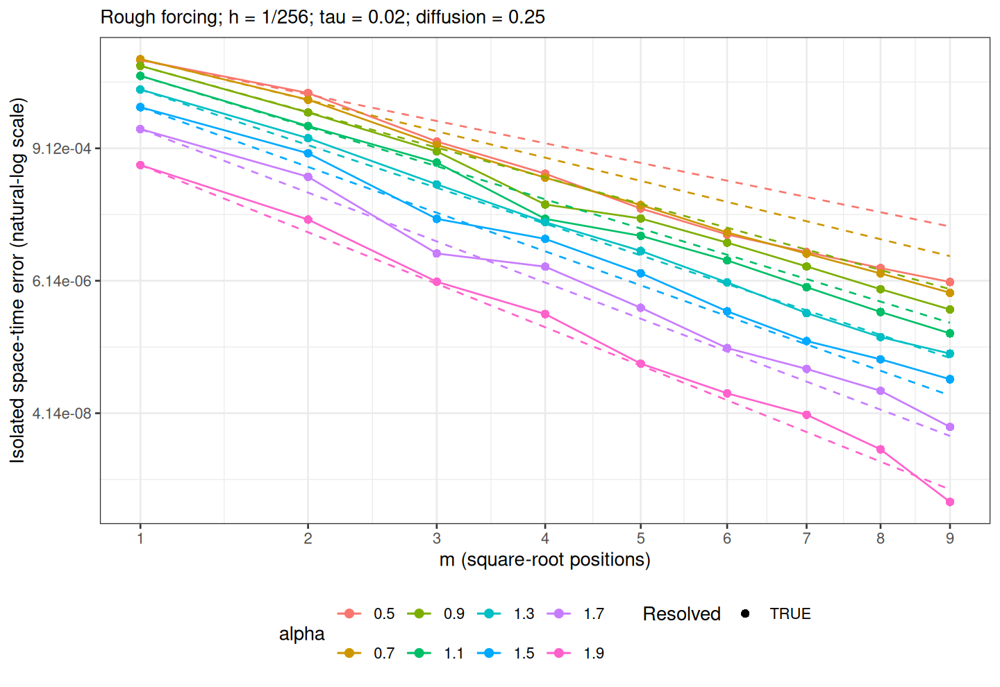

[Experiments](index.html) · [Theory and functions](brasilfunc.html)

Knit displays the saved selected run. To run a new experiment, edit the
**Parameters for the next run** chunk, then run the setup, parameters, and
recompute chunks manually in that order. The parameter and recompute chunks
have `eval=FALSE` and are skipped when knitting. Recompute overwrites only
this experiment's saved data, selected coefficient export, and figures.

```{r setup, include=FALSE}
knitr::opts_chunk$set(engine="R",message=FALSE,warning=FALSE,error=FALSE,cache=FALSE)
helper <- tempfile(fileext=".R")
knitr::purl("brasilfunc.Rmd",output=helper,quiet=TRUE)
sys.source(helper,envir=environment())
unlink(helper)
r <- readRDS("data_files/isolated_m_rough_results.rds")
stopifnot(identical(r$coefficient_source,"rSPDE BRASIL"),
          identical(r$parameters$study,"isolated_m_rough"))
```

## Rough forcing and the matched discrete problem

Use the same tadpole and infinite rough forcing as the h and tau rough
experiments:
$$
u_t+\nu L^{\alpha/2}u=g,\qquad u(0)=0,\qquad L=\kappa^2-\Delta_\Gamma,
$$
$$
g=\sum_{j=1}^\infty \frac{\phi_j}{j},\qquad
\phi_j=0\text{ on the stem},\qquad
\phi_j(x)=\sin(2^j\pi x)\text{ on the loop }[0,2].
$$
The forcing belongs to L2 but has no positive spectral Sobolev regularity.
On the aligned mesh $h=2^{-J}$, modes $j\ge J$ have exactly zero sine--hat
load integrals. Therefore assembling the load with $j=1,\ldots,J-1$ gives
the FEM projection of the same infinite forcing.

Both evolutions use the same consistent P1 mass matrix $C$, stiffness
matrix $K=\kappa^2C+G$, zero initial vector, and constant load
$F_i=(g,\psi_i)$. This study measures only the rational approximation error:
$$
E_m^2=\tau\sum_{k=1}^N
(U_{h,m}^k-U_{h,\mathrm{frac}}^k)^\top C
(U_{h,m}^k-U_{h,\mathrm{frac}}^k).
$$
The unresolved continuum modes cancel in this comparison. An infinite-tail
term would measure an additional continuum error, so it is not added to
$E_m$. This differs from the h/tau rough experiments, which compare against
the continuum solution and must include that tail.

### Fractional reference and rational matrix evolution

The exact-discrete reference uses the complete numerical eigensystem
$$KV=CV\Lambda,\qquad V^\top CV=I$$
and the backward Euler recurrence
$$
x_i^0=0,\qquad
x_i^k=\frac{x_i^{k-1}+\tau(V^\top F)_i}
               {1+\tau\nu\lambda_i^{\alpha/2}},\qquad
U_{h,\mathrm{frac}}^k=Vx^k.
$$
“Exact” means the fractional power of the assembled discrete operator,
up to numerical eigendecomposition error; time stepping is still backward
Euler. Every numerical eigenmode is retained in this reference.

The rational evolution uses `my.fractional.operators.frac()` and
`my.solver.frac()`. It applies shifted sparse solves at every time step
and retains the BRASIL constant contribution through a mass-matrix solve.
Its eigensystem-based counterpart is an independent diagnostic, not the
solver used for the plotted error.

Matrices are assembled directly in the invariant quarter-loop subspace
$[0,1/2]$, with Dirichlet endpoints. Signed reflections recover the full
loop and the stem stays zero. The matrices and loads include a factor of
four, so the mass norm is the full-graph norm. This is the same invariant
FEM subspace as in the rough h/tau notebooks; it makes the complete
fractional reference inexpensive without changing these data.

## Selected settings and coefficients

The diagnostic sweep and rejected candidates are kept in
`/home/rierasl/Desktop/DOCS/NAP/isolated_m_rough_study_2026-11-01`.
Selection balances a common decreasing order range and the straightness
of log(error) against sqrt(m) for all eight alphas. It does not tune the
forcing or alter BRASIL entries to match the dashed benchmark.

The selected run uses $J=8$, $h=1/256$, $\tau=0.02$, $\nu=0.25$,
and $m=1,\ldots,9$. The screening considered orders through 14. Some
higher-order errors have resolved reversals; the selected range is a
common decreasing window, not a claim that rational errors must decrease
at every order. The diffusion differs from the unit diffusion in the
rough spatial notebook and stays fixed across this entire m-study.
The screening rule requires decreasing curves and worst-alpha $R^2\ge0.99$,
then favors the longest common order range and highest worst-alpha $R^2$.
This is a selection criterion within the tested grid, not a global optimum.
Mesh refinement changes the excited spectrum and the measured slopes:
these fits describe the selected finite FEM problem, not mesh-independent
asymptotic exponents.

All poles, residues, and constants come from exact rows of the installed
`rSPDE` BRASIL tables. Only rows used by the selected run are exported in
`data_files/isolated_m_rough/coefficients.csv` and stored in the saved RDS.
They describe the inverse-power approximant; the solver derives the
time-step partial fractions from them.

## Parameters for the next run

```{r parameters, eval=FALSE}
J <- 8L
tau <- 0.02
m_max <- 9L
alpha_vector <- seq(0.5,1.9,0.2)
T_final <- 1
kappa <- 4
diffusion <- 0.25
```

```{r recompute, eval=FALSE}
output_file <- "data_files/isolated_m_rough_results.rds"
figure_dir <- "data_files/isolated_m_rough"

stopifnot(length(m_max)==1L,is.finite(m_max),m_max>=2L,
          m_max==as.integer(m_max),all(seq_len(m_max) %in% brasil_supported_orders()),
          length(alpha_vector)>0L,!anyDuplicated(alpha_vector),
          all(is.finite(alpha_vector)),all(alpha_vector>0 & alpha_vector<=2),
          length(tau)==1L,is.finite(tau),tau>0,
          length(T_final)==1L,is.finite(T_final),T_final>0,
          length(diffusion)==1L,is.finite(diffusion),diffusion>0)
N <- round(T_final/tau)
if (!is.finite(N) || N<1L || N>1e6 ||
    abs(T_final/tau-N)>64*.Machine$double.eps*max(1,N))
    stop("Choose an integer T_final/tau between 1 and 1e6.")
time_seq <- (0:N)*tau
m_vector <- seq_len(m_max)
data <- isolated_rough_tadpole_data(J,kappa)
spectrum <- isolated_discrete_spectrum(data$C,data$L)

# Preserve exactly the installed coefficient rows used in this run.
coefficient_rows <- list()
coefficient_tables <- list()
for (alpha in alpha_vector[alpha_vector!=2]) for (m in m_vector) {
    cf <- brasil_coefficients(m,alpha/2)
    if (!isolated_beta_bracket(m,alpha/2)$exact)
        stop("This rough study requires exact BRASIL beta rows.")
    coefficient_rows[[length(coefficient_rows)+1L]] <- list(alpha=alpha,
        m=m,beta=alpha/2,poles=cf$poles,residues=cf$residues,constant=cf$constant)
    coefficient_tables[[length(coefficient_tables)+1L]] <- data.frame(
        alpha=alpha,beta=alpha/2,m=m,term=seq_len(m),
        pole=cf$poles,residue=cf$residues,constant=cf$constant)
}

control_ref <- isolated_rough_be_reference(data,spectrum,time_seq,2,diffusion)
control <- isolated_rational_error(data,spectrum,control_ref,m=1L)
rows <- list()
for (alpha in alpha_vector) {
    reference <- isolated_rough_be_reference(data,spectrum,time_seq,alpha,diffusion)
    reference_norm <- sqrt(tau*sum(reference$coefficients[,-1L,drop=FALSE]^2))
    for (m in m_vector) {
        value <- isolated_rational_error(data,spectrum,reference,m)
        value$reference_norm <- reference_norm
        value$relative_error <- value$error/reference_norm
        value$noise_indicator <- max(value$absolute_error_disagreement,
                                    control$error,.Machine$double.xmin)
        value$resolved <- value$product_error>100*value$noise_indicator
        rows[[length(rows)+1L]] <- value
    }
}
results <- do.call(rbind,rows)
errors <- matrix(results$error,nrow=length(m_vector),
                 dimnames=list(m=m_vector,alpha=alpha_vector))
fit_slope <- function(d) {
    d <- d[is.finite(d$error) & d$error>0,]
    if (nrow(d)<2L) return(c(slope=NA_real_,r_squared=NA_real_))
    model <- lm(log(error)~sqrt(m),data=d)
    c(slope=unname(coef(model)[2L]),r_squared=summary(model)$r.squared)
}
slopes <- do.call(rbind,lapply(alpha_vector,function(a) {
    d <- results[results$alpha==a,]
    fit <- fit_slope(d)
    data.frame(alpha=a,benchmark=-2*pi*sqrt(a/2),
      all_orders_slope=unname(fit["slope"]),r_squared=unname(fit["r_squared"]),
      resolved_orders=sum(d$resolved),
      resolved_only_slope=unname(fit_slope(d[d$resolved,])["slope"]),
      reversals=sum(diff(d$error)>0),relative_endpoint=tail(d$relative_error,1L))
}))

plot_data <- results
plot_data$alpha_label <- factor(plot_data$alpha,levels=alpha_vector)
guides <- plot_data
for (a in alpha_vector) {
    ids <- which(guides$alpha==a)
    guides$error[ids] <- guides$error[ids[1L]] *
        exp(-2*pi*sqrt(a/2)*(sqrt(guides$m[ids])-1))
}
plot <- ggplot2::ggplot(plot_data,ggplot2::aes(sqrt(m),error,
            colour=alpha_label,group=alpha_label)) +
    ggplot2::geom_line() +
    ggplot2::geom_point(ggplot2::aes(shape=resolved),size=2) +
    ggplot2::geom_line(data=guides,linetype="dashed") +
    ggplot2::scale_shape_manual(values=c(`FALSE`=1,`TRUE`=16)) +
    ggplot2::scale_x_continuous(breaks=sqrt(m_vector),labels=m_vector) +
    ggplot2::scale_y_continuous(trans=scales::log_trans(base=exp(1)),
                               labels=scales::label_scientific()) +
    ggplot2::labs(x="m (square-root positions)",
      y="Isolated space-time error (natural-log scale)",colour="alpha",
      shape="Resolved",
      subtitle=sprintf("Rough forcing; h = 1/%d; tau = %g; diffusion = %g",
                       2^J,tau,diffusion)) +
    ggplot2::theme_bw() + ggplot2::theme(legend.position="bottom")

dir.create(figure_dir,recursive=TRUE,showWarnings=FALSE)
ggplot2::ggsave(file.path(figure_dir,"plot.png"),plot,
               width=8,height=5.5,dpi=180,bg="white")
ggplot2::ggsave(file.path(figure_dir,"plot.pdf"),plot,
               width=8,height=5.5,bg="white")
coefficient_table <- if (length(coefficient_tables)) do.call(rbind,coefficient_tables) else
    data.frame(alpha=numeric(),beta=numeric(),m=integer(),term=integer(),
               pole=numeric(),residue=numeric(),constant=numeric())
write.csv(coefficient_table,file.path(figure_dir,"coefficients.csv"),row.names=FALSE)
result <- list(
    parameters=list(study="isolated_m_rough",J=J,h=2^-J,tau=tau,N=N,
      m_max=m_max,alpha_vector=alpha_vector,T_final=T_final,kappa=kappa,
      diffusion=diffusion,initial="zero",forcing="fixed infinite sum phi_j/j",
      projected_forcing_modes=data$projected_forcing_modes,
      reconstruction="right-constant backward Euler",
      subspace="quarter-loop with full-graph mass normalization"),
    coefficient_source="rSPDE BRASIL",
    rSPDE_version=as.character(utils::packageVersion("rSPDE")),
    coefficients=coefficient_rows,results=results,errors=errors,slopes=slopes,
    diagnostics=spectrum$diagnostics,control=control,
    source_hashes=tools::md5sum(c("brasilfunc.Rmd","conv_in_m_isolated_rough.Rmd")),
    generated_at=format(Sys.time(),"%Y-%m-%d %H:%M:%S %Z",tz="Asia/Riyadh"))
dir.create(dirname(output_file),recursive=TRUE,showWarnings=FALSE)
saveRDS(result,output_file)
r <- result
```

## Saved settings

```{r settings, echo=FALSE}
p <- r$parameters
knitr::kable(data.frame(J=p$J,h=p$h,tau=p$tau,N=p$N,m_max=p$m_max,
  T=p$T_final,kappa=p$kappa,diffusion=p$diffusion,
  dimension=r$diagnostics$dimension,forcing_modes=p$projected_forcing_modes))
```

## Saved convergence plot and regression

```{r convergence, echo=FALSE, out.width="800px"}

```

The horizontal coordinate is $\sqrt m$, with ticks labelled by m. The
vertical coordinate is the natural logarithm of the isolated norm $E_m$;
tick labels show error values. Colored solid lines and markers are the
sparse matrix-solver errors. Dashed lines are
$$
E_1\exp\left[-2\pi\sqrt{\alpha/2}\,(\sqrt m-1)\right].
$$
The subtraction of 1 anchors each guide at its measured m=1 error.
The reference exponent is prescribed; it is not a fitted regression slope
or a certified error bound. Open markers are below the empirical numerical
resolution threshold and are excluded from resolved-only fits.

The regression estimates a free intercept and slope in
$\log E_m=c+s\sqrt m$, separately for each alpha and over all saved orders.
The resolved-only slope is also shown. Neither fit imposes monotonicity.

```{r slopes, echo=FALSE}
knitr::kable(r$slopes,digits=6)
```

```{r errors, echo=FALSE}
knitr::kable(r$errors,format.args=list(scientific=TRUE,digits=6))
```

## Selected-run numerical checks

The complete generalized eigensystem is checked for relative residuals
and C-orthogonality. An independent spectral rational evolution checks
the sparse error. An alpha=2 classical backward Euler control checks
numerical disagreement without rational approximation.

A point is called resolved when its independent spectral error exceeds
100 times the larger of the sparse/spectral error-norm disagreement and
the classical control error. This is an empirical resolution check.
The same-space relative error is $E_m/\|U_{h,\mathrm{frac}}\|_{L_2(0,T;L_2)}$.

```{r checks, echo=FALSE}
knitr::kable(r$diagnostics,format.args=list(scientific=TRUE,digits=6))
knitr::kable(r$control[,c("error","product_error","final_state_gap_C")],
             format.args=list(scientific=TRUE,digits=6))
knitr::kable(r$results[,c("alpha","m","error","relative_error",
    "absolute_error_disagreement","final_state_gap_C","resolved")],
    format.args=list(scientific=TRUE,digits=6))
```

The parameter sweep, mesh/time sensitivity comparisons, checks against
full-graph evolution, and higher-order diagnostics remain in DOCS/NAP.
This notebook contains the selected run and its reproducible computation.
