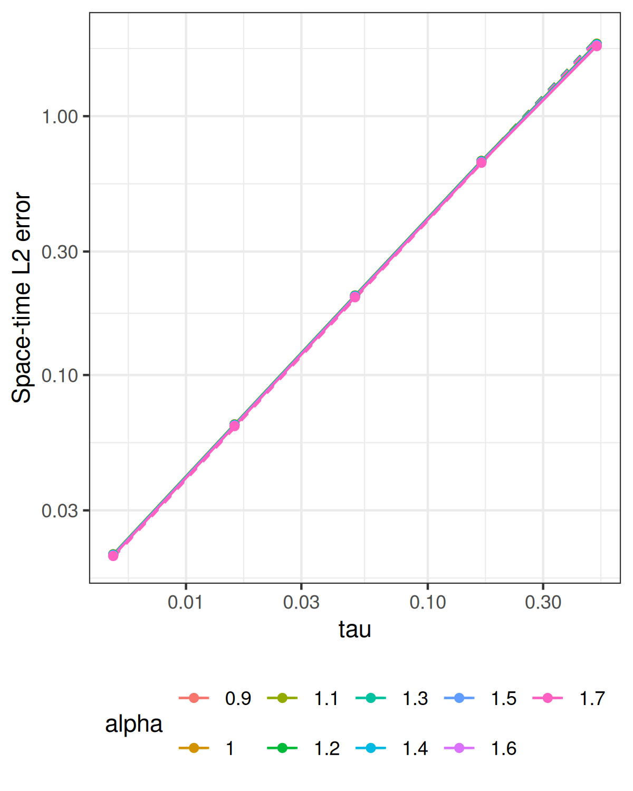

[Experiments](index.html) · [Theory and functions](brasilfunc.html)

Knit displays the saved results. To run a new experiment, edit the **Parameters
for the next run** chunk, then run the setup, parameters, and recompute chunks
manually in that order. The computation loops, error calculations, plotting,
and saving steps are written directly below. The recompute chunk overwrites the saved results and
figures. Knit again to display them. Parameter and recompute chunks are skipped
when knitting; the displayed settings always describe the saved results.

```{r setup, include=FALSE}
knitr::opts_chunk$set(message=FALSE,warning=FALSE,error=FALSE,cache=FALSE)
helper <- tempfile(fileext = ".R")
knitr::purl("brasilfunc.Rmd", output = helper, quiet = TRUE)
sys.source(helper, envir = environment())
unlink(helper)
saved <- new.env()
load("data_files/errors_projected_tau_mat.RData", envir=saved)
errors_projected <- saved$errors_projected
p <- attr(errors_projected,"parameters")
stopifnot(identical(attr(errors_projected,"coefficient_source"),"rSPDE BRASIL"),
          identical(p$study,"tau"))
```

## Problem and matrix method

On the tadpole with stem length 1 and loop length 2, solve
$$
u_t+\nu L^{\alpha/2}u=a_f A\sin(\omega t)e_7,
\qquad u(0)=a_0e_5,\qquad L=\kappa^2-\Delta_\Gamma.
$$
The data contain finitely many smooth eigenfunctions; the editable amplitudes
are `initial_amplitude` and `forcing_amplitude`, with sine factor `AAA` and
frequency `OMEGA`. Consistent P1 mass
and stiffness matrices are assembled on the tadpole. Every backward Euler
step applies shifted sparse matrix solves using the installed `rSPDE`
BRASIL poles, residues, and constant. Cholesky factors are reused, including
the mass-matrix factor for the constant contribution. Analytic sine–hat
loads and interval-averaged forcing are used.

The reported error is the right-constant space–time $L_2$ error against the
continuum solution, evaluated on the saved reference mesh and time grid.
Centered coefficient moments accumulate this norm without changing the FEM
time evolution. The reference modes evaluate the continuum solution only.

## Parameters for the next run

```{r parameters, eval=FALSE}
T_final <- 1
kappa <- 4
diffusion <- 1e-3
alpha_vector <- seq(0.5,1.9,0.2)
m_fixed <- 8L
tau_vector <- T_final/c(200L,80L,32L,13L,6L,2L)
h_fixed <- 1e-3
overkill_h <- 1e-5
overkill_time_step <- 1e-5
N_finite <- 4L
initial_amplitude <- 10
forcing_amplitude <- 10
AAA <- 1
OMEGA <- pi
workers <- 1L
error_method <- "compressed"
error_n_blocks <- 1L
error_verbose <- FALSE
```

```{r recompute, eval=FALSE}
# Saved files overwritten by this computation.
output_file <- "data_files/errors_projected_tau_mat.RData"
figure_file <- "data_files/tikzpic/p_tau_nicer_tadpole_mat_with_mathpazo.png"

# Assemble FEM matrices and advance every backward Euler step.
stopifnot(N_finite >= 4, N_finite%%2 == 0, length(alpha_vector) > 0, all(is.finite(alpha_vector)),
    all(alpha_vector > 0 & alpha_vector <= 2), length(m_fixed) == 1, m_fixed == floor(m_fixed))
for (alpha in alpha_vector[alpha_vector != 2]) brasil_coefficients(m_fixed, alpha/2)
adjusted_N_finite <- N_finite + N_finite/2 + 1
coeff_U_0 <- numeric(adjusted_N_finite)
coeff_U_0[5] <- initial_amplitude
coeff_FF <- numeric(adjusted_N_finite)
coeff_FF[7] <- forcing_amplitude
tau_targets <- tau_vector
time_grids <- lapply(tau_targets, function(target) {
    make_time_grid(T_final = T_final, target_step = target)
})
tau_vector <- vapply(time_grids, function(grid) grid$time_step, numeric(1))
stopifnot(length(unique(tau_vector)) == length(tau_vector))
g_averages <- lapply(time_grids, function(grid) {
    average_sine_forcing(grid$time_seq, A = AAA, omega = OMEGA)
})
# Assemble the reference-mesh mass matrix.
overkill_graph <- gets.graph.tadpole(h = overkill_h)
overkill_graph$compute_fem()
overkill_C <- overkill_graph$mesh$C
error_memory <- estimate_error_memory(n_reference_nodes = nrow(overkill_C), n_exact_modes = if (error_method ==
    "compressed")
    sum(coeff_U_0 != 0 | coeff_FF != 0) else NULL, n_reference_samples = ceiling(T_final/overkill_time_step), n_blocks = unique(c(error_n_blocks,
    10, 100, 1000, 10000, 1e+05, 1e+06)), n_solver_steps = vapply(time_grids, function(grid) grid$N,
    numeric(1)))
print(error_memory, digits = 3, row.names = FALSE)
reference_grid <- make_time_grid(T_final = T_final, target_step = overkill_time_step)
overkill_time_step <- reference_grid$time_step
overkill_time_seq <- reference_grid$time_seq
graph <- gets.graph.tadpole(h = h_fixed)
graph$compute_fem()
C <- graph$mesh$C
L <- kappa^2 * C + graph$mesh$G
Psi <- graph$fem_basis(overkill_graph$get_mesh_locations())
stopifnot(all(coeff_U_0[-5] == 0))
U_0 <- project_u0_tadpole(graph, amplitude = coeff_U_0[5])
reference_eigen_params <- gets.eigen.params(N_finite = N_finite, kappa = kappa, alpha = alpha_vector[1],
    graph = overkill_graph)
reference_eigenvalues <- reference_eigen_params$EIGENVAL
overkill_EIGENFUN <- reference_eigen_params$EIGENFUN
active_modes <- which(coeff_U_0 != 0 | coeff_FF != 0)
exact_basis <- overkill_EIGENFUN[, active_modes, drop = FALSE]
exact_initial <- coeff_U_0[active_modes]
exact_forcing <- coeff_FF[active_modes]
spatial_load <- coeff_FF[7] * assemble_e7_load_tadpole(graph)
error_projection <- if (error_method == "compressed")
    prepare_reference_error(Psi, overkill_C, exact_basis) else NULL
m_values <- c()
# Loop over the refinement values and fractional exponents.
errors_projected <- matrix(NA_real_, length(tau_vector), length(alpha_vector))
for (j in seq_along(alpha_vector)) {
    alpha <- alpha_vector[j]
    beta <- alpha/2
    exact_rates <- diffusion * reference_eigenvalues[active_modes]^beta
    coefficients_at_time <- function(t) exact_modal_coefficients(t, exact_rates, exact_initial, exact_forcing,
        A = AAA, omega = OMEGA)
    exact_at_time <- function(t) exact_basis %*% coefficients_at_time(t)
    cases <- run_reference_cases(seq_along(tau_vector), function(i) {
        time_grid <- time_grids[[i]]
        time_step <- time_grid$time_step
        time_seq <- time_grid$time_seq
        g_average <- g_averages[[i]]
        m <- m_fixed
        my_op_frac <- my.fractional.operators.frac(L = L, beta = beta, C = C, scale.factor = kappa^2,
            m = m, time_step = time_step, diffusion = diffusion)
        solve_fractional_evolution_error(my_op_frac, time_step, time_seq, U_0, spatial_load, g_average,
            Psi, overkill_C, overkill_time_seq, exact_at_time, n_blocks = error_n_blocks, verbose = error_verbose,
            error_method = error_method, coefficients_at_time = coefficients_at_time, error_projection = error_projection)
    }, workers = workers)
    errors_projected[, j] <- vapply(cases, base::identity, numeric(1))
}
# Save the errors together with the settings used for this run.
attr(errors_projected, "coefficient_source") <- "rSPDE BRASIL"
attr(errors_projected, "parameters") <- list(study = "tau", axis = tau_vector, alpha = alpha_vector,
    m = m_fixed, diffusion = diffusion, kappa = kappa, T = T_final, reference_h = overkill_h, reference_tau = overkill_time_step,
    N_finite = N_finite, initial_amplitude = initial_amplitude, forcing_amplitude = forcing_amplitude,
    AAA = AAA, OMEGA = OMEGA, fixed = list(h = h_fixed))
dir.create(dirname(output_file), recursive = TRUE, showWarnings = FALSE)
save(errors_projected, file = output_file)


# Fit reference guides, draw the curves, and overwrite the saved figure.
errors <- errors_projected
axis <- tau_vector
alpha <- alpha_vector
study <- "tau"
frame <- expand.grid(row = seq_along(axis), column = seq_along(alpha))
frame$x <- axis[frame$row]
frame$error <- as.vector(errors)
frame$alpha <- factor(alpha[frame$column], levels = alpha)
guide <- frame
rate <- if (study == "h")
    2 else 1
for (j in seq_along(alpha)) {
    ids <- frame$column == j
    constant <- exp(mean(log(errors[, j]/axis^rate)))
    guide$error[ids] <- constant * guide$x[ids]^rate
}
plot <- ggplot2::ggplot(frame, ggplot2::aes(x, error, color = alpha, group = alpha)) + ggplot2::geom_line(data = guide,
    linetype = "dashed") + ggplot2::geom_line() + ggplot2::geom_point() + ggplot2::scale_x_log10() +
    ggplot2::scale_y_log10() + ggplot2::labs(x = study, y = "Space-time L2 error", color = "alpha") +
    ggplot2::theme_bw() + ggplot2::theme(legend.position = "bottom")
dir.create(dirname(figure_file), recursive = TRUE, showWarnings = FALSE)
ggplot2::ggsave(figure_file, plot, width = 4, height = 5, dpi = 300, bg = "white")
```

## Saved parameters

```{r load-results, include=FALSE}
load("data_files/errors_projected_tau_mat.RData", envir=saved)
errors_projected <- saved$errors_projected
p <- attr(errors_projected,"parameters")
```

```{r saved-parameters, echo=FALSE}
knitr::kable(data.frame(T=p$T,kappa=p$kappa,diffusion=p$diffusion,m=p$m,
  reference_h=p$reference_h,reference_tau=p$reference_tau,
  fixed_h=p$fixed$h))
# Original saved runs used these amplitudes and sine settings.
# New runs record the values explicitly in their metadata.
a0 <- if(is.null(p$initial_amplitude)) 10 else p$initial_amplitude
af <- if(is.null(p$forcing_amplitude)) 10 else p$forcing_amplitude
A <- if(is.null(p$AAA)) 1 else p$AAA
omega <- if(is.null(p$OMEGA)) pi else p$OMEGA
knitr::kable(data.frame(initial_amplitude=a0,forcing_amplitude=af,AAA=A,OMEGA=omega))
```

The reference temporal rate is one; the spatial mesh and rational order
remain fixed throughout each refinement curve.

## Saved results

```{r saved-figure, echo=FALSE, out.width="650px"}

```

```{r saved-rates, echo=FALSE}
observed <- apply(errors_projected,2,function(e)
  unname(coef(lm(log10(e)~log10(p$axis)))[2]))
knitr::kable(data.frame(alpha=p$alpha,reference=1,observed=observed),digits=5)
```

```{r saved-errors, echo=FALSE}
knitr::kable(data.frame(tau=p$axis,errors_projected,check.names=FALSE),
  col.names=c("tau",paste("alpha =",p$alpha)),
  format.args=list(scientific=TRUE,digits=5))
```
