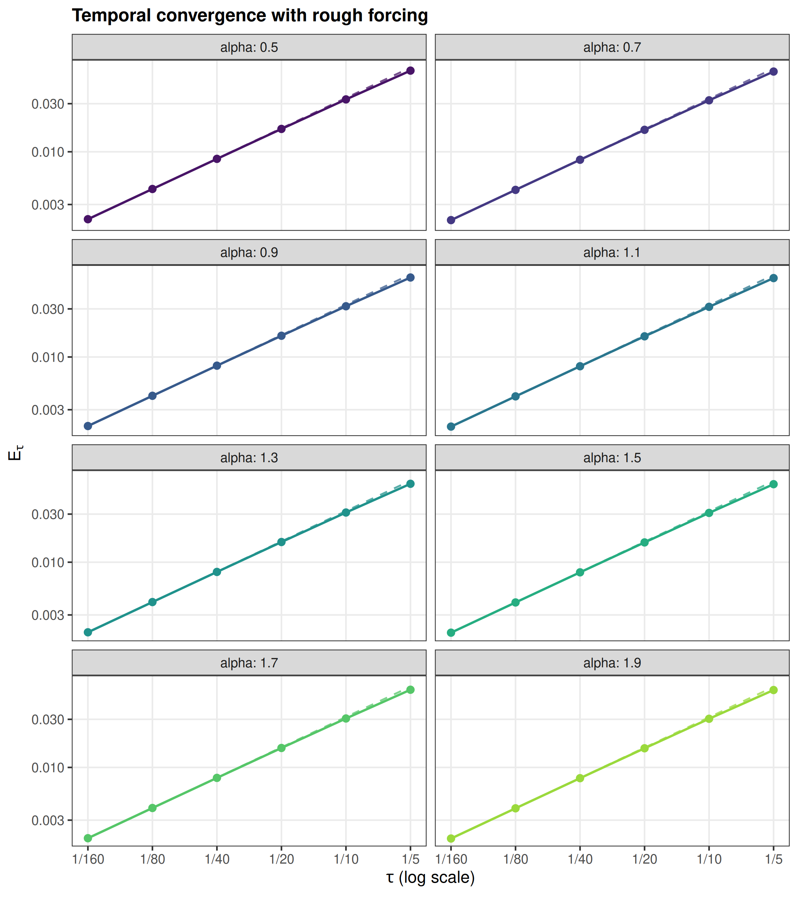

[Experiments](index.html) · [Theory and functions](brasilfunc.html)

Knit displays the saved results. To run a new experiment, edit the **Parameters
for the next run** chunk, then run the setup, parameters, and recompute chunks
manually in that order. The computation loops, error calculations, plotting,
and saving steps are written directly below. The recompute chunk overwrites the saved results and
figures. Knit again to display them. Parameter and recompute chunks are skipped
when knitting; the displayed settings always describe the saved results.

```{r setup, include=FALSE}
knitr::opts_chunk$set(message=FALSE,warning=FALSE,error=FALSE,
  echo=TRUE,cache=FALSE,fig.align="center",dpi=150)
helper <- tempfile(fileext = ".R")
knitr::purl("brasilfunc.Rmd", output = helper, quiet = TRUE)
sys.source(helper, envir = environment())
unlink(helper)
rough_tau_result <- readRDS("data_files/rough_tau_results.rds")
p <- rough_tau_result$parameters
```

# Problem and exact solution

Use the same tadpole and the same infinite rough forcing as in
[the spatial experiment](conv_in_h_rough.html). The stem has length $1$,
the loop has length $2$, and
$$
\partial_tu+\nu_\alpha L^{\alpha/2}u=g,\qquad u(0)=0,
\qquad L=\kappa^2-\Delta_\Gamma,\quad \kappa=`r p$kappa`,\quad T=`r p$T_final`.
$$
The forcing is fixed across all meshes and all values of $\alpha$:
$$
g=\sum_{j=1}^{\infty}\frac1j\phi_j,
\qquad
\phi_j(s)=
\begin{cases}
0,&s\text{ on the stem},\\
\sin(2^j\pi x),&s=x\in[0,2]\text{ on the loop}.
\end{cases}
$$
These orthonormal eigenfunctions have eigenvalues
$\mu_j=\kappa^2+\pi^2 2^{2j}$. Thus $g\in L_2(\Gamma)$ but
$g\notin\dot H^s(\Gamma)$ for every $s>0$. Writing
$a_j=\nu_\alpha\mu_j^{\alpha/2}$, the exact solution is
$$
u(s,t)=\sum_{j=1}^{\infty}\frac{1-e^{-a_jt}}{j\,a_j}\phi_j(s).
$$

::: {.custom-box}
Backward Euler has first-order temporal convergence. Here we measure
$$
E(\tau)=\|u-U_{h,m}^{\tau}\|_{L_2(0,T;L_2(\Gamma))}
$$
against the exact continuum solution, including its unresolved infinite tail.
For each $\alpha$, the mesh, rational order, and diffusion coefficient remain
fixed as $\tau$ varies. They are chosen so that spatial and rational errors
remain small compared with the temporal error over the reported range.
The reference slope is $1$ for every $\alpha$.
:::

# Matrix discretization and settings

The default diffusion setting compares temporal rates on the same time scale:
$$
\nu_\alpha=(\kappa^2+4\pi^2)^{-\alpha/2},
\qquad a_1=\nu_\alpha\mu_1^{\alpha/2}=1.
$$
This puts the slowest forced mode on the same time scale for every
$\alpha$. The diffusion coefficient is held fixed along each curve.
This temporal experiment uses these coefficients instead of the unit
diffusion used in the spatial experiment.

The solver uses consistent P1 mass and stiffness matrices, analytic
sine–hat loads, and shifted sparse solves at every backward Euler step.
The matrices are assembled directly on the invariant quarter-loop
$[0,1/2]$, with Dirichlet endpoints. Signed reflections recover the full
loop solution and the stem solution is zero. A factor of four in the
matrices and integrals accounts for the full graph. This is the same FEM
matrix evolution used in the spatial experiment; it uses no discrete
eigenfunction recurrence.

The rational inverse uses positive BRASIL coefficients from `rSPDE`, including
its constant term. All shifted factorizations are reused within a run.
The error uses the consistent mass norm, a stable spatial projection residual,
and exact time moments for the right-constant reconstruction. Modes
$j\geq J$ on a mesh $h=2^{-J}$ have zero load but remain in the exact
error through a certified infinite-tail sum. There is no reference-grid
sampling or replacement of the forcing by a finite series.

# Parameters for the next run

```{r parameters, eval=FALSE}
alpha_vector <- seq(0.5,1.9,0.2)
T_final <- 1
kappa <- 4
J_vector <- c(20L,16L,13L,11L,10L,9L,8L,8L)
N_vector <- c(5L,10L,20L,40L,80L,160L)
diffusion <- (kappa^2+4*pi^2)^(-alpha_vector/2)
m_fixed <- c(20L,rep(14L,7L))
fit_indices <- 4:6
projection_quadrature <- 16L
tail_tolerance <- 1e-13
workers <- 1L
```

```{r recompute, eval=FALSE}
# Saved files overwritten by this computation.
output_file <- "data_files/rough_tau_results.rds"
output_dir <- "data_files/rough_tau"
root <- getwd()
cache_dir <- tempdir()
checkpoint_dir <- tempfile("rough-tau-checkpoints-")

parameters <- list(alpha=alpha_vector,J=J_vector,T_final=T_final,
  kappa=kappa,diffusion=diffusion,projection_quadrature=projection_quadrature,
  tail_tolerance=tail_tolerance,N=N_vector,rational_orders=m_fixed,
  fit_indices=fit_indices,forcing="same fixed infinite L2 forcing as conv_in_h_rough",
  reconstruction="right-constant backward Euler",
  error_integration="exact time moments, stable projection residual, certified infinite tail")

# Execute the refinement study and compute regression rates.
stopifnot(length(parameters$alpha) == length(parameters$J), length(parameters$alpha) == length(parameters$diffusion),
    length(parameters$alpha) == length(parameters$rational_orders), all(parameters$fit_indices %in%
        seq_along(parameters$N)), workers >= 1)
dir.create(checkpoint_dir, recursive = TRUE, showWarnings = FALSE)
dir.create(dirname(output_file), recursive = TRUE, showWarnings = FALSE)
rough_compile_solver(root, cache_dir)
provenance <- list(parameters = parameters, sources = tools::md5sum(file.path(root, "brasilfunc.Rmd")))
# Each alpha curve keeps its mesh fixed and refines the time grid.
run_alpha <- function(a) {
    checkpoint <- file.path(checkpoint_dir, sprintf("alpha%03d.rds", round(100 * parameters$alpha[a])))
    if (file.exists(checkpoint)) {
        saved <- readRDS(checkpoint)
        if (!identical(saved$provenance, provenance))
            stop("Temporal checkpoint source/settings mismatch.")
        return(saved$values)
    }
    message(sprintf("Preparing tau curve: alpha=%.1f, J=%d", parameters$alpha[a], parameters$J[a]))
    mesh <- rough_tau_mesh(parameters$J[a], parameters$kappa)
    projection <- rough_tau_projection(mesh, parameters$projection_quadrature)
    values <- lapply(parameters$N, function(N) {
        value <- rough_tau_solve(mesh, parameters$alpha[a], N, parameters$rational_orders[a], parameters$diffusion[a],
            parameters$T_final, projection, parameters$tail_tolerance)
        value$states <- value$final_state <- NULL
        message(sprintf("alpha=%.1f, N=%d, error=%.10g, %.2fs", parameters$alpha[a], N, value$error,
            value$elapsed))
        value
    })
    saveRDS(list(provenance = provenance, values = values), checkpoint)
    values
}
safe_alpha <- function(a) tryCatch(run_alpha(a), error = function(e) list(failed = TRUE, message = conditionMessage(e)))
curves <- if (workers > 1L && .Platform$OS.type == "unix")
    parallel::mclapply(seq_along(parameters$alpha), safe_alpha, mc.cores = min(workers, length(parameters$alpha)),
        mc.preschedule = FALSE) else lapply(seq_along(parameters$alpha), safe_alpha)
failed <- vapply(curves, function(x) !is.list(x) || isTRUE(x$failed) || inherits(x, "try-error"),
    logical(1))
if (any(failed))
    stop("Temporal matrix experiment failed: ", paste(vapply(curves[failed], function(x) if (is.list(x))
        x$message else as.character(x), character(1)), collapse = "; "))
errors <- vapply(curves, function(x) vapply(x, `[[`, numeric(1), "error"), numeric(length(parameters$N)))
tau <- parameters$T_final/parameters$N
fit <- parameters$fit_indices
slope <- function(e) unname(coef(stats::lm(log10(e[fit]) ~ log10(tau[fit])))[2])
observed <- apply(errors, 2L, slope)
result <- list(parameters = parameters, tau = tau, errors = errors, rates = data.frame(alpha = parameters$alpha,
    theoretical = 1, observed = observed, relative_error_percent = 100 * abs(observed - 1)), curves = curves,
    provenance = provenance, generated_at = format(Sys.time(), "%Y-%m-%d %H:%M:%S %Z", tz = "Asia/Riyadh"),
    session_info = utils::sessionInfo())
saveRDS(result, output_file)
rough_tau_result <- result

# Draw reference guides and overwrite the saved figures.
p <- result$parameters
errors <- result$errors
fit <- p$fit_indices
constants <- apply(errors[fit, , drop = FALSE]/result$tau[fit], 2L, function(x) exp(mean(log(x))))
frame <- expand.grid(index = seq_along(result$tau), column = seq_along(p$alpha))
frame$tau <- result$tau[frame$index]
frame$error <- as.vector(errors)
frame$alpha <- factor(p$alpha[frame$column], levels = p$alpha)
guide <- frame
guide$error <- guide$tau * constants[guide$column]
plot <- ggplot2::ggplot(frame, ggplot2::aes(tau, error, color = alpha, group = alpha)) + ggplot2::geom_line(data = guide,
    linetype = "dashed", linewidth = 0.65, alpha = 0.75) + ggplot2::geom_line(linewidth = 0.8) +
    ggplot2::geom_point(size = 2.1) + ggplot2::scale_x_log10(breaks = result$tau, labels = function(x) paste0("1/",
    round(1/x))) + ggplot2::scale_y_log10() + ggplot2::scale_color_viridis_d(option = "D", begin = 0.05,
    end = 0.85) + ggplot2::facet_wrap(~alpha, ncol = 2L, labeller = ggplot2::label_both) + ggplot2::labs(x = expression(tau ~
    "(log scale)"), y = expression(E[tau]), color = expression(alpha), title = "Temporal convergence with rough forcing") +
    ggplot2::theme_bw(base_size = 12) + ggplot2::theme(legend.position = "none", panel.grid.minor = ggplot2::element_blank(),
    plot.title = ggplot2::element_text(size = 13, face = "bold"))
dir.create(output_dir,recursive=TRUE,showWarnings=FALSE)
for(extension in c("png","pdf")) ggplot2::ggsave(
  file.path(output_dir,paste0("conv_tau_rough.",extension)),plot,
  width=8,height=9,dpi=300,bg="white")
```

# Saved parameters

```{r load-results, include=FALSE}
rough_tau_result <- readRDS("data_files/rough_tau_results.rds")
p <- rough_tau_result$parameters
```

```{r saved-common-parameters, echo=FALSE}
knitr::kable(data.frame(T=p$T_final,kappa=p$kappa))
```


The actual uniform time steps are $\tau=T/N$ for
$N\in$ `r paste(p$N,collapse=", ")`. The following settings remain fixed along each
temporal refinement curve:

```{r settings, echo=FALSE}
knitr::kable(data.frame(alpha=p$alpha,
  h=paste0("1/",2^p$J),nu=formatC(p$diffusion,format="f",digits=8),
  m=p$rational_orders),
  col.names=c("$\\alpha$","$h$","$\\nu_\\alpha$","$m$"),
  align=c("r","r","r","r"))
```

# Results

Solid lines and markers show the computed matrix-solver errors. Dashed
lines have slope $1$, with constants fitted over the saved time steps
selected by `fit_indices`, `r paste(p$fit_indices,collapse=", ")`. The same steps are used for the
reported regression slopes. Separate panels make all eight curves visible.

```{r convergence, echo=FALSE, out.width="760px", fig.cap="Temporal convergence for the fixed infinite rough forcing. Each dashed line has slope one. The mesh, diffusion coefficient, and rational order are fixed within each panel."}

```

```{r rates, echo=FALSE}
rates <- rough_tau_result$rates
knitr::kable(rates,digits=c(1,1,4,2),
  col.names=c("$\\alpha$","Reference","Observed slope","Relative error (%)"),
  caption="Temporal regression slopes over the saved fit steps.")
```

The observed slopes range from
`r sprintf("%.4f", min(rates$observed))` to
`r sprintf("%.4f", max(rates$observed))`. The reference temporal order is one. The saved curves should be checked
for spatial and rational error floors when interpreting these slopes.

```{r errors, echo=FALSE, results='asis'}
errors <- data.frame(tau=paste0("1/",p$N),
  apply(rough_tau_result$errors,2L,function(x)formatC(x,format="e",digits=6)))
names(errors) <- c("$\\tau$",paste0("$\\alpha=",p$alpha,"$"))
cat('<div style="overflow-x:auto">\n',
  knitr::kable(errors,format="html",caption="Computed space–time errors.",
    table.attr='class="table table-condensed" style="font-size:13px; white-space:nowrap"'),
  '\n</div>\n')
```
