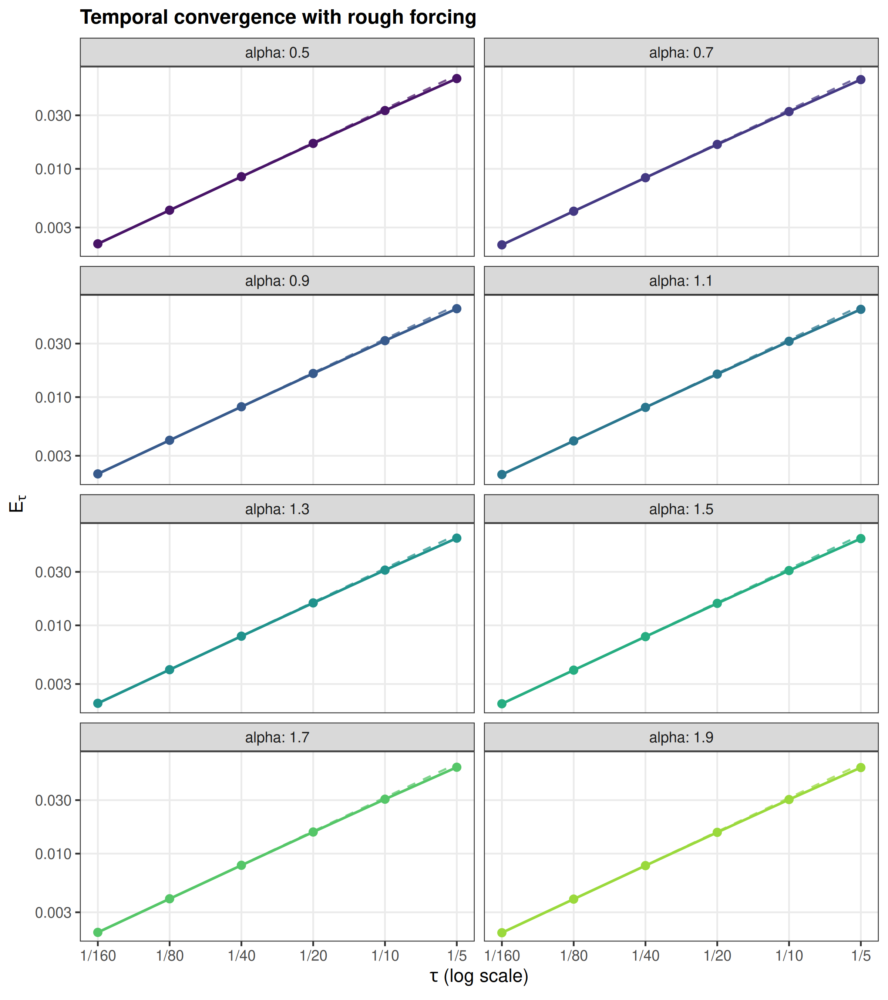

Go back to the [Contents](about.html) page.

```{r setup, include=FALSE}
knitr::opts_chunk$set(message=FALSE,warning=FALSE,error=FALSE,
  echo=TRUE,cache=FALSE,fig.align="center",dpi=150)
source("fun/rough/tau/load.R")
rough_tau_result <- readRDS("data_files/rough_tau_results.rds")
stopifnot(identical(rough_tau_result$parameters,rough_tau_parameters()))
p <- rough_tau_result$parameters
```

# Problem and exact solution

Use the same tadpole and the same infinite rough forcing as in
[the spatial experiment](conv_in_h_rough.html). The stem has length $1$,
the loop has length $2$, and
$$
\partial_tu+\nu_\alpha L^{\alpha/2}u=g,\qquad u(0)=0,
\qquad L=\kappa^2-\Delta_\Gamma,\quad \kappa=4,\quad T=1.
$$
The forcing is fixed across all meshes and all values of $\alpha$:
$$
g=\sum_{j=1}^{\infty}\frac1j\phi_j,
\qquad
\phi_j(s)=
\begin{cases}
0,&s\text{ on the stem},\\
\sin(2^j\pi x),&s=x\in[0,2]\text{ on the loop}.
\end{cases}
$$
These orthonormal eigenfunctions have eigenvalues
$\mu_j=\kappa^2+\pi^2 2^{2j}$. Thus $g\in L_2(\Gamma)$ but
$g\notin\dot H^s(\Gamma)$ for every $s>0$. Writing
$a_j=\nu_\alpha\mu_j^{\alpha/2}$, the exact solution is
$$
u(s,t)=\sum_{j=1}^{\infty}\frac{1-e^{-a_jt}}{j\,a_j}\phi_j(s).
$$

::: {.custom-box}
Backward Euler has first-order temporal convergence. Here we measure
$$
E(\tau)=\|u-U_{h,m}^{\tau}\|_{L_2(0,T;L_2(\Gamma))}
$$
against the exact continuum solution, including its unresolved infinite tail.
For each $\alpha$, the mesh, rational order, and diffusion coefficient remain
fixed as $\tau$ varies. They are chosen so that spatial and rational errors
remain small compared with the temporal error over the reported range.
The reference slope is $1$ for every $\alpha$.
:::

# Matrix discretization and settings

To compare temporal rates on the same time grid, choose
$$
\nu_\alpha=(\kappa^2+4\pi^2)^{-\alpha/2},
\qquad a_1=\nu_\alpha\mu_1^{\alpha/2}=1.
$$
This puts the slowest forced mode on the same time scale for every
$\alpha$. The diffusion coefficient is held fixed along each curve.
This temporal experiment uses these coefficients instead of the unit
diffusion used in the spatial experiment.

The solver uses consistent P1 mass and stiffness matrices, analytic
sine–hat loads, and shifted sparse solves at every backward Euler step.
The matrices are assembled directly on the invariant quarter-loop
$[0,1/2]$, with Dirichlet endpoints. Signed reflections recover the full
loop solution and the stem solution is zero. A factor of four in the
matrices and integrals accounts for the full graph. This is the same FEM
matrix evolution used in the spatial experiment; it uses no discrete
eigenfunction recurrence.

The rational inverse uses positive BRASIL coefficients from `rSPDE`, including
its constant term. All shifted factorizations are reused within a run.
The error uses the consistent mass norm, a stable spatial projection residual,
and exact time moments for the right-constant reconstruction. Modes
$j\geq J$ on a mesh $h=2^{-J}$ have zero load but remain in the exact
error through a certified infinite-tail sum. There is no reference-grid
sampling or replacement of the forcing by a finite series.

```{r parameters}
alpha_vector <- seq(0.5,1.9,0.2)
N_vector <- p$N
tau_vector <- p$T_final/N_vector
h_fixed <- 2^-p$J
diffusion <- p$diffusion
m_fixed <- p$rational_orders
```

The actual uniform time steps are $\tau=T/N$ for
$N=5,10,20,40,80,160$. The following settings remain fixed along each
temporal refinement curve:

```{r settings, echo=FALSE}
knitr::kable(data.frame(alpha=p$alpha,
  h=paste0("1/",2^p$J),nu=formatC(p$diffusion,format="f",digits=8),
  m=p$rational_orders),
  col.names=c("$\\alpha$","$h$","$\\nu_\\alpha$","$m$"),
  align=c("r","r","r","r"))
```

# Results

Solid lines and markers show the computed matrix-solver errors. Dashed
lines have slope $1$, with constants fitted over the three finest time
steps, $\tau=1/40,1/80,1/160$. The same three steps are used for the
reported regression slopes. Separate panels make all eight curves visible.

```{r convergence, echo=FALSE, out.width="760px", fig.cap="Temporal convergence for the fixed infinite rough forcing. Each dashed line has slope one. The mesh, diffusion coefficient, and rational order are fixed within each panel."}

```

```{r rates, echo=FALSE}
rates <- rough_tau_result$rates
knitr::kable(rates,digits=c(1,1,4,2),
  col.names=c("$\\alpha$","Reference","Observed slope","Relative error (%)"),
  caption="Temporal regression slopes over the three finest time steps.")
```

The observed slopes range from
`r sprintf("%.4f", min(rates$observed))` to
`r sprintf("%.4f", max(rates$observed))`, consistent with first-order
temporal convergence. Spatial and rational refinement checks confirm that
their error floors do not mask this behavior.

```{r errors, echo=FALSE, results='asis'}
errors <- data.frame(tau=paste0("1/",p$N),
  apply(rough_tau_result$errors,2L,function(x)formatC(x,format="e",digits=6)))
names(errors) <- c("$\\tau$",paste0("$\\alpha=",p$alpha,"$"))
cat('<div style="overflow-x:auto">\n',
  knitr::kable(errors,format="html",caption="Computed space–time errors.",
    table.attr='class="table table-condensed" style="font-size:13px; white-space:nowrap"'),
  '\n</div>\n')
```
