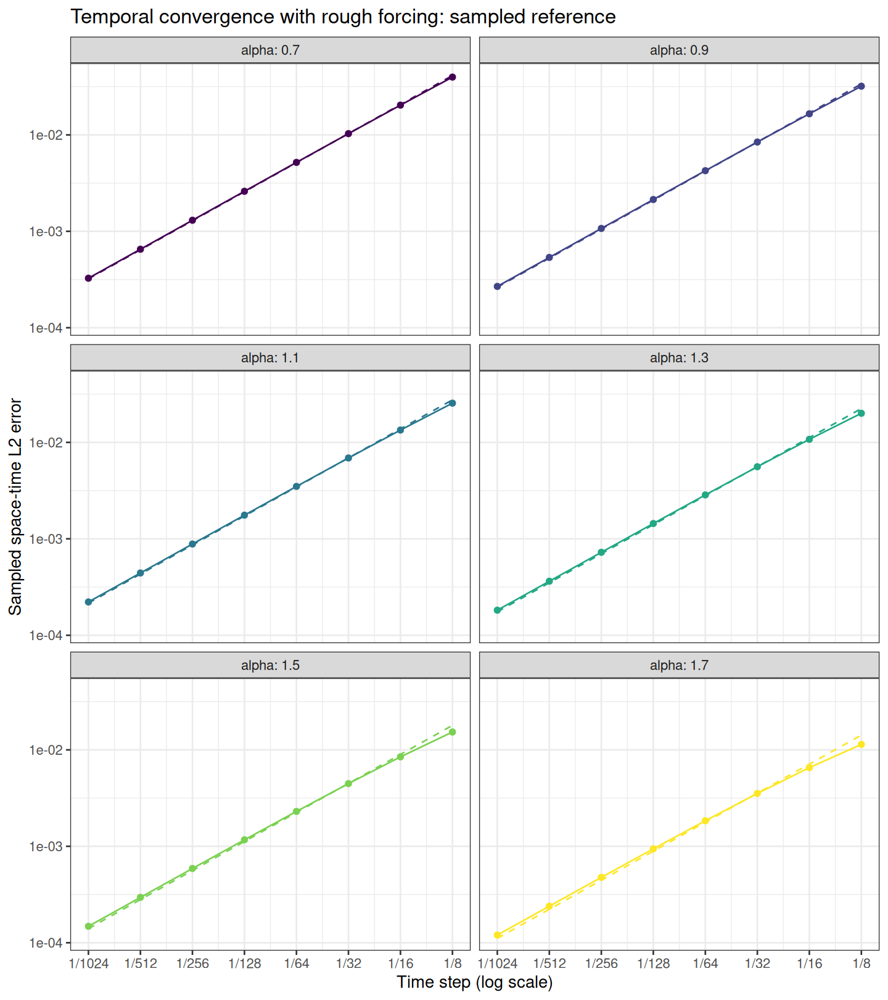

[Experiments](index.html) · [Theory and functions](brasilfunc.html)

Knit displays saved results. To run a new experiment, edit **Parameters for
the next run**, then manually run setup, parameters, and recompute in that
order. The parameter and recompute chunks are skipped when knitting.
Recompute overwrites only this experiment's results and figures.

```{r setup, include=FALSE}
knitr::opts_chunk$set(message=FALSE, warning=FALSE, error=FALSE, cache=FALSE)
helper <- tempfile(fileext=".R")
knitr::purl("brasilfunc.Rmd", output=helper, quiet=TRUE)
sys.source(helper, envir=environment())
unlink(helper)
result <- readRDS("data_files/rough_tau_as_in_mat_results.rds")
p <- result$parameters
stopifnot(identical(result$coefficient_source, "rSPDE BRASIL"),
          identical(p$study, "rough_tau_sampled_reference"))
```

## The experiment

This is a consistent-parameter rough temporal study, evaluated with
the sampled reference-mesh workflow of `conv_in_tau_mat.Rmd` and
`cov_in_h_rough_as_in_mat.Rmd`. On the tadpole with stem length 1 and loop
length 2, solve
$$
u_t+\nu L^{\alpha/2}u=g,\qquad u(0)=0,
\qquad L=\kappa^2-\Delta_\Gamma,
$$
where the same infinite forcing is used for every time step and exponent:
$$
g=\sum_{j=1}^{\infty}\frac{\phi_j}{j},\qquad
\phi_j=0\text{ on the stem},\quad
\phi_j(x)=\sin(2^j\pi x)\text{ on the loop }[0,2].
$$
It belongs to $L_2(\Gamma)$ and has no positive spectral Sobolev regularity.
With $\mu_j=\kappa^2+\pi^2 2^{2j}$ and
$a_j=\nu\mu_j^{\alpha/2}$, the exact continuum solution is
$$
u(t)=\sum_{j=1}^{\infty}b_j(t)\phi_j,
\qquad b_j(t)=\frac{1-e^{-a_jt}}{j a_j}.
$$

For each $\alpha$, refine only $\tau=T/N$. The solver mesh, rational order,
diffusion coefficient, reference cutoff, reference mesh, and reference time
grid stay fixed along that curve. The reference temporal order is **one**.
The three consistent rough studies use the same six exponents
$\alpha=0.7,0.9,\ldots,1.7$, $\nu=0.25$, $\kappa=4$, and $T=1$.
The endpoint exponents 0.5 and 1.9 are omitted consistently from all three
after the joint diagnostics. Every retained exponent uses the same grid
and fit window; the original endpoint diagnostics are preserved.
The h and tau axes are the same eight values $2^{-10},\ldots,2^{-3}$.
Their span is 128, preserving eight consecutive dyadic refinement levels.
The fixed temporal mesh and isolated mesh are both $h=2^{-20}$;
the fixed spatial step and isolated step are both $\tau=10^{-7}$.
Both sampled-reference studies use m=14, cutoff 20, reference $h=2^{-22}$,
and reference $\tau=10^{-5}$. Every axis point and every isolated order
$m=1,\ldots,9$ is retained. No fit window is chosen to match a benchmark.

Diagnostics and rejected candidates are retained in
`/home/rierasl/Desktop/DOCS/NAP/consistent_rough_parameters_2026-11-02`.
Selection requires small fixed-parameter sensitivity and well-resolved
all-point curves; it does not rank isolated slopes against the dashed guide.
These are the best qualifying settings in the recorded grid, not a global optimum.

### Sampled error and reference truncation

The reference is the finite analytic series
$$u_K(t)=\sum_{j=1}^{K}b_j(t)\phi_j.$$
Only the reference is truncated. On an aligned solver mesh $h=2^{-J}$,
modes $j\ge J$ have zero sine–hat load integrals, so the original infinite
forcing is assembled exactly using $j=1,\ldots,J-1$. Require
$K\ge\max J-1$ throughout the study.

Let $E$ contain the retained eigenfunctions evaluated at reference nodes,
$C_{\rm ref}$ be the consistent reference P1 mass matrix, and $\Psi$
evaluate solver hat functions at those nodes. At reference times $s_q$,
use the new solver state $U^{k(q)}$ on $(t_{k(q)-1},t_{k(q)}]$. Measure
$$
\widehat E(\tau)^2=
\sum_q(s_q-s_{q-1})
\big(Eb(s_q)-\Psi U^{k(q)}\big)^\top C_{\rm ref}
\big(Eb(s_q)-\Psi U^{k(q)}\big).
$$
This is the reference-mass/right-endpoint-time norm used in the smooth
matrix study. No PDE is solved on the reference mesh. The uniform P1 matrices have an exact invariant space spanned by the
interpolants of $\sin(2^j\pi x)$, $j=1,\ldots,J-1$. All other FEM
coordinates remain exactly zero for this load and zero initial data.
The computation uses mass-normalized coordinates in this space, where
$C=I$ and $K$ contains the **discrete P1 eigenvalues**. It retains every
forced FEM mode. The rational evolution still applies the shifted sparse
matrix solves and the BRASIL constant at every step.

On nested dyadic grids the reference Gram matrices and cross products are
available in closed form. `rough_invariant_projection()` gives exactly the
same reference-mass sampled norm as explicit nodal interpolation. This
algebraic reduction removes large reference histories and mesh arrays;
it changes neither the FEM problem nor the reference cutoff or time sum.
Comparisons against the original quarter-loop matrices, loads, sampled
norms, and complete numerical eigensystems are saved with the diagnostics.

In the exact continuum norm, orthogonality gives
$$
\|u-U_{h,m}^\tau\|^2
=\|u_K-U_{h,m}^\tau\|^2+\|u-u_K\|^2,
$$
and
$$
\|u-u_K\|^2\le B_K=
\frac{T}{\nu^2\pi^{2\alpha}}
\frac{2^{-2\alpha(K+1)}}{(K+1)^2(1-2^{-2\alpha})}.
$$
The bound is recorded and checked against the measured squared error. It
is **not added to the plotted error**. Spatial interpolation and reference
time sampling must be checked separately. To avoid unresolved dyadic
reference modes, enforce `reference_J >= reference_cutoff + 2` and a
reference mesh finer than every solver mesh. The cutoff and reference
resolutions must be reconsidered if the refinement range is extended.

## Parameters for the next run

```{r parameters, eval=FALSE}
T_final <- 1
kappa <- 4
alpha_vector <- seq(0.7,1.7,0.2)
diffusion <- 0.25
J_fixed <- 20L
J_vector <- rep(J_fixed,length(alpha_vector))
J_axis <- 10:3
tau_vector <- 2^-J_axis
N_vector <- as.integer(T_final/tau_vector)
m_fixed <- 14L
reference_cutoff <- 20L
reference_J <- 22L
reference_time_step <- 1e-5
fit_indices <- seq_along(tau_vector)
max_tail_squared_fraction <- 0.002
```

```{r recompute, eval=FALSE}
output_file <- "data_files/rough_tau_as_in_mat_results.rds"
output_dir <- "data_files/rough_tau_as_in_mat"
stopifnot(length(alpha_vector)>0L, !anyDuplicated(alpha_vector),
    all(is.finite(alpha_vector)), all(alpha_vector>0 & alpha_vector<2),
    length(J_vector)==length(alpha_vector), all(is.finite(J_vector)),
    all(J_vector==as.integer(J_vector)), all(J_vector>=3 & J_vector<=22),
    length(diffusion)==1L, all(is.finite(diffusion)), all(diffusion>0),
    length(m_fixed)==1L, all(is.finite(m_fixed)),
    all(m_fixed==as.integer(m_fixed)), all(m_fixed>=1 & m_fixed<=20),
    length(N_vector)>=2L, !anyDuplicated(N_vector), all(is.finite(N_vector)),
    all(N_vector>=1 & N_vector==as.integer(N_vector)), all(N_vector<=1e7),
    length(fit_indices)>=2L, !anyDuplicated(fit_indices),
    all(fit_indices==as.integer(fit_indices)), all(fit_indices %in% seq_along(N_vector)),
    length(T_final)==1L, is.finite(T_final), T_final>0,
    length(kappa)==1L, is.finite(kappa), kappa>0,
    length(reference_cutoff)==1L, is.finite(reference_cutoff),
    reference_cutoff==as.integer(reference_cutoff), reference_cutoff>=max(J_vector)-1L,
    length(reference_J)==1L, is.finite(reference_J), reference_J==as.integer(reference_J),
    reference_J>max(J_vector), reference_J>=reference_cutoff+2L,
    length(reference_time_step)==1L, is.finite(reference_time_step), reference_time_step>0,
    ceiling(T_final/reference_time_step)<=2e6,
    length(max_tail_squared_fraction)==1L, is.finite(max_tail_squared_fraction),
    max_tail_squared_fraction>0, max_tail_squared_fraction<1)
for (a in seq_along(alpha_vector))
    rough_rational_coefficients(alpha_vector[a]/2, m_fixed)
rough_compile_sampled_solver()
reference <- rough_invariant_reference(reference_J, reference_cutoff)
reference_grid <- make_time_grid(T_final, reference_time_step)
time_grids <- lapply(N_vector, function(N)
    list(N=N, time_step=T_final/N, time_seq=seq(0,T_final,length.out=N+1L)))
tau <- T_final/N_vector
cutoff_squared_bound <- T_final/(diffusion^2*pi^(2*alpha_vector)) *
    2^(-2*alpha_vector*(reference_cutoff+1))/
    ((reference_cutoff+1)^2*(1-2^(-2*alpha_vector)))
errors <- matrix(NA_real_, length(N_vector), length(alpha_vector))
cases <- vector("list", length(alpha_vector))
for (a in seq_along(alpha_vector)) {
    message(sprintf("Preparing sampled tau curve: alpha=%.1f, J=%d", alpha_vector[a],J_vector[a]))
    mesh <- rough_invariant_mesh(J_vector[a], kappa)
    projection <- rough_invariant_projection(mesh,reference)
    values <- lapply(seq_along(N_vector), function(i) {
        grid <- time_grids[[i]]
        started <- proc.time()[["elapsed"]]
        value <- rough_sampled_error(mesh,reference,projection,alpha_vector[a],
            grid$time_step,reference_time_step,m_fixed,diffusion,T_final)
        error <- value$error
        if (!is.finite(error) || error<=0) stop("Invalid sampled error.")
        fraction <- cutoff_squared_bound[a]/error^2
        if (!is.finite(fraction) || fraction>max_tail_squared_fraction)
            stop("Reference cutoff budget failed; increase cutoff and resolve it spatially.")
        message(sprintf("alpha=%.1f, N=%d, error=%.10g",alpha_vector[a],grid$N,error))
        list(error=error,N=grid$N,tau=grid$time_step,
            omitted_squared_fraction=fraction,
            elapsed=proc.time()[["elapsed"]]-started)
    })
    errors[,a] <- vapply(values, `[[`, numeric(1), "error")
    cases[[a]] <- values
    rm(mesh,projection)
    gc(verbose=FALSE)
}
fit <- fit_indices
rates <- data.frame(alpha=alpha_vector, theoretical=1,
    observed=apply(errors,2L,function(e)
        unname(coef(lm(log10(e[fit])~log10(tau[fit])))[2L])))
result <- list(parameters=list(study="rough_tau_sampled_reference",
    T_final=T_final,kappa=kappa,alpha=alpha_vector,J=J_vector,h=2^-J_vector,
    diffusion=diffusion,rational_orders=m_fixed,N=N_vector,fit_indices=fit_indices,
    reference_cutoff=reference_cutoff,reference_J=reference_J,reference_h=reference$h,
    reference_tau=reference_grid$time_step,reference_N=reference_grid$N,
    reference_nodes=reference$physical_dimension,
    evolved_modes=J_vector-1L,
    solver_coordinates="exact forced P1 invariant subspace",axis_span=128,excluded_alpha=c(0.5,1.9),
    max_tail_squared_fraction=max_tail_squared_fraction,
    forcing="fixed infinite sum phi_j/j; zero on stem",
    reconstruction="right-constant backward Euler",
    error="sampled finite-series reference with consistent P1 reference mass"),
    coefficient_source="rSPDE BRASIL",rSPDE_version=as.character(utils::packageVersion("rSPDE")),
    tau=tau,errors=errors,rates=rates,cases=cases,cutoff_squared_bound=cutoff_squared_bound,
    max_tail_squared_fraction=apply(sweep(errors^2,2L,cutoff_squared_bound,
        function(squared,bound) bound/squared),2L,max),
    source_hashes=tools::md5sum(c("brasilfunc.Rmd","conv_in_tau_rough_as_in_mat.Rmd")),
    generated_at=format(Sys.time(),"%Y-%m-%d %H:%M:%S %Z",tz="Asia/Riyadh"))

frame <- expand.grid(row=seq_along(tau),column=seq_along(alpha_vector))
frame$tau <- tau[frame$row]
frame$error <- as.vector(errors)
frame$alpha <- factor(alpha_vector[frame$column],levels=alpha_vector)
guide <- frame
for (a in seq_along(alpha_vector)) {
    constant <- exp(mean(log(errors[fit,a]/tau[fit])))
    guide$error[guide$column==a] <- constant*guide$tau[guide$column==a]
}
plot <- ggplot2::ggplot(frame,ggplot2::aes(tau,error,color=alpha,group=alpha)) +
    ggplot2::geom_line(data=guide,linetype="dashed") +
    ggplot2::geom_line() + ggplot2::geom_point() +
    ggplot2::scale_x_log10(breaks=tau,labels=function(x)paste0("1/",round(1/x))) +
    ggplot2::scale_y_log10() + ggplot2::scale_color_viridis_d() +
    ggplot2::facet_wrap(~alpha,ncol=2L,labeller=ggplot2::label_both) +
    ggplot2::labs(x="Time step (log scale)",y="Sampled space-time L2 error",
        title="Temporal convergence with rough forcing: sampled reference") +
    ggplot2::theme_bw() + ggplot2::theme(legend.position="none")
dir.create(output_dir,recursive=TRUE,showWarnings=FALSE)
for (extension in c("png","pdf")) ggplot2::ggsave(
    file.path(output_dir,paste0("conv_tau_rough_as_in_mat.",extension)),
    plot,width=8,height=9,dpi=180,bg="white")
dir.create(dirname(output_file),recursive=TRUE,showWarnings=FALSE)
saveRDS(result,output_file)
p <- result$parameters
```

## Saved settings and results

```{r saved-settings, echo=FALSE}
knitr::kable(data.frame(T=p$T_final,kappa=p$kappa,cutoff=p$reference_cutoff,
    reference_J=p$reference_J,reference_h=p$reference_h,
    reference_tau=p$reference_tau,reference_nodes=p$reference_nodes))
knitr::kable(data.frame(alpha=p$alpha,J=p$J,h=p$h,diffusion=p$diffusion,
    m=p$rational_orders,
    omitted_squared_bound=formatC(result$cutoff_squared_bound,format="e",digits=4),
    max_omitted_squared_fraction=formatC(result$max_tail_squared_fraction,format="e",digits=4)),digits=8)
```

The time steps are $\tau=T/N$ for
$N\in$ `r paste(p$N,collapse=", ")`. Fits use
$N\in$ `r paste(p$N[p$fit_indices],collapse=", ")`.
Dashed guides have slope one, with constants fitted on those same steps.
The regressions freely estimate the slopes of the raw errors.

```{r saved-figure, echo=FALSE, out.width="800px"}

```

```{r saved-rates, echo=FALSE}
knitr::kable(result$rates,digits=6)
knitr::kable(data.frame(tau=result$tau,result$errors,check.names=FALSE),
    col.names=c("tau",paste0("alpha=",p$alpha)),digits=8)
```

The theorem predicts a first-order temporal contribution, with spatial and
rational errors fixed on each curve. These can cause an error floor under
continued time refinement. The sampled errors approximate the theorem's
continuum norm; reference refinement and the cutoff budget must remain
small relative to the measured error. The analytic-time/infinite-tail
alternative remains available in `conv_in_tau_rough.Rmd`.

## Accuracy checks for the saved run

```{r saved-validation, echo=FALSE}
if (!is.null(result$validation)) knitr::kable(result$validation,digits=6)
```

Reference-time, reference-space, and cutoff refinements are checked at the
finest axis point for every retained exponent. Fixed-mesh refinement and an
exact fractional FEM comparison check spatial and rational contamination.
The saved diagnostics cover all six exponents; these numerical sensitivity
checks are not certified error enclosures. See the common diagnostic directory above.
