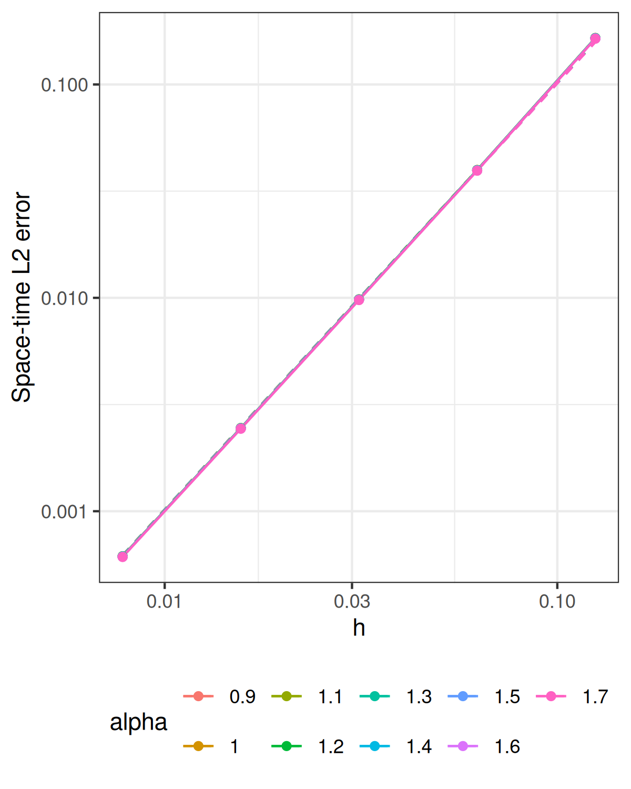

[Experiments](index.html) · [Theory and functions](brasilfunc.html)

Knit displays the saved results with the parameters below. The recomputation
chunk is disabled; run it manually only to replace the saved experiment.

```{r setup, include=FALSE}
knitr::opts_chunk$set(message=FALSE,warning=FALSE,error=FALSE,cache=FALSE)
helper <- tempfile(fileext = ".R")
knitr::purl("brasilfunc.Rmd", output = helper, quiet = TRUE)
sys.source(helper, envir = environment())
unlink(helper)
saved <- new.env()
load("data_files/errors_projected_h_mat.RData", envir=saved)
errors_projected <- saved$errors_projected
p <- attr(errors_projected,"parameters")
stopifnot(identical(attr(errors_projected,"coefficient_source"),"rSPDE BRASIL"),
          identical(p$study,"h"))
```

## Problem and matrix method

On the tadpole with stem length 1 and loop length 2, solve
$$
u_t+\nu L^{\alpha/2}u=10\sin(\pi t)e_7,
\qquad u(0)=10e_5,\qquad L=\kappa^2-\Delta_\Gamma.
$$
The data contain finitely many smooth eigenfunctions. Consistent P1 mass
and stiffness matrices are assembled on the tadpole. Every backward Euler
step applies shifted sparse matrix solves using the installed `rSPDE`
BRASIL poles, residues, and constant. Cholesky factors are reused, including
the mass-matrix factor for the constant contribution. Analytic sine–hat
loads and interval-averaged forcing are used.

The reported error is the right-constant space–time $L_2$ error against the
continuum solution, evaluated on the saved reference mesh and time grid.
Centered coefficient moments accumulate this norm without changing the FEM
time evolution. The reference modes evaluate the continuum solution only.

## Current parameters

```{r parameters}
T_final <- 1
kappa <- 4
diffusion <- 1e-3
alpha_vector <- seq(0.5,1.9,0.2)
m_fixed <- 8L
overkill_h <- 1e-5
overkill_time_step <- 1e-5
h_vector <- 2^seq(-7,-3)
time_step <- 2e-5
stopifnot(isTRUE(all.equal(p$axis,h_vector)),
          isTRUE(all.equal(p$alpha,alpha_vector)),p$m==m_fixed,
          p$diffusion==diffusion,p$kappa==kappa,p$T==T_final,
          p$reference_h==overkill_h,p$reference_tau==overkill_time_step,
          isTRUE(all.equal(p$fixed$tau,time_step)))
```

The smooth finite-mode data exhibit second-order spatial convergence on
this range. General low-regularity spatial bounds allow the slower rate
$h^{\alpha-\epsilon}$. Temporal and rational error floors can mask either rate.
The saved curves use the second-order reference slope.

## Saved results

```{r saved-figure, echo=FALSE, out.width="650px"}

```

```{r saved-rates, echo=FALSE}
observed <- apply(errors_projected,2,function(e)
  unname(coef(lm(log10(e)~log10(h_vector)))[2]))
knitr::kable(data.frame(alpha=alpha_vector,reference=2,observed=observed),digits=5)
```

```{r saved-errors, echo=FALSE}
knitr::kable(data.frame(h=h_vector,errors_projected,check.names=FALSE),
  col.names=c("h",paste("alpha =",alpha_vector)),
  format.args=list(scientific=TRUE,digits=5))
```

## Recompute explicitly

All implementation functions are in [brasilfunc.Rmd](brasilfunc.html).
The current saved results are preserved until this chunk is run manually.

```{r recompute, eval=FALSE}
errors_projected <- run_smooth_h(workers=1L)
```
