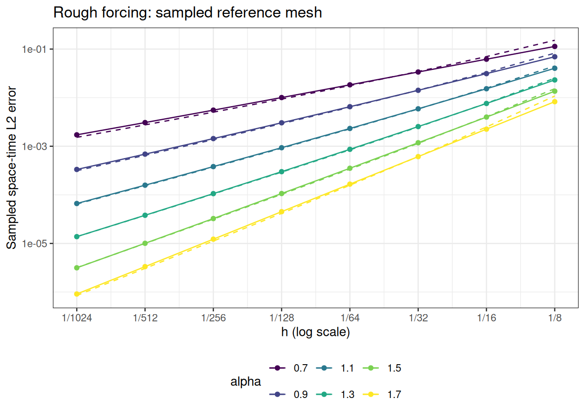
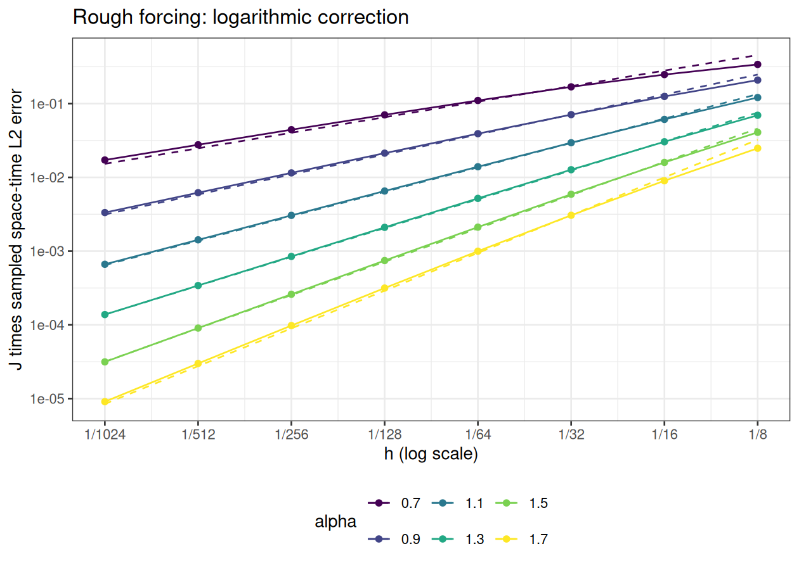

[Experiments](index.html) · [Theory and functions](brasilfunc.html)

Knit displays the saved selected results. To recompute, edit **Parameters
for the next run**, then run setup, parameters, and recompute manually in
that order. Parameters and recompute have `eval=FALSE`. Recompute overwrites
only this experiment's results and figures.

```{r setup, include=FALSE}
knitr::opts_chunk$set(engine="R",message=FALSE,warning=FALSE,error=FALSE,cache=FALSE)
helper <- tempfile(fileext=".R")
knitr::purl("brasilfunc.Rmd",output=helper,quiet=TRUE)
sys.source(helper,envir=environment())
unlink(helper)
r <- readRDS("data_files/rough_h_as_in_mat_results.rds")
p <- r$parameters
stopifnot(identical(r$coefficient_source,"rSPDE BRASIL"),
          identical(p$study,"rough_h_sampled_reference"))
```

## The experiment

This notebook applies the reference-mesh workflow of `cov_in_h_mat.Rmd`
to the infinite rough forcing of `conv_in_h_rough.Rmd`. On the tadpole with
stem length 1 and loop length 2,
$$
u_t+\nu L^{\alpha/2}u=g,\qquad u(0)=0,\qquad
L=\kappa^2-\Delta_\Gamma,
$$
$$
g=\sum_{j=1}^{\infty}\frac{\phi_j}{j},\qquad
\phi_j=0\text{ on the stem},\quad
\phi_j(x)=\sin(2^j\pi x)\text{ on the loop }[0,2].
$$
This forcing belongs to L2 and has no positive spectral Sobolev regularity.
With $\mu_j=\kappa^2+\pi^2 2^{2j}$ and $a_j=\nu\mu_j^{\alpha/2}$,
the continuum solution is
$$u(t)=\sum_{j=1}^{\infty}\frac{1-e^{-a_jt}}{j a_j}\phi_j.$$

The stages are:

1. Build a finite-series analytic reference on a fixed fine spatial mesh
   and reference time grid.
2. Assemble zero initial data, consistent P1 FEM matrices, and the analytic
   hat-function loads on each solver mesh.
3. Advance backward Euler using installed `rSPDE` BRASIL coefficients and
   shifted sparse matrix solves, including the constant contribution.
4. Measure the sampled reference-grid space-time error as h varies.
5. Fit raw and logarithmically corrected convergence slopes.

### A finite reference and the original forcing

The sampled reference is explicitly truncated:
$$
u_K(t)=\sum_{j=1}^{K}\frac{1-e^{-a_jt}}{j a_j}\phi_j.
$$
K stays fixed as the solver mesh is refined. It is a reference cutoff,
distinct from the rational order m and from the mesh index J.
The solver still assembles the original infinite forcing: on the aligned
mesh $h=2^{-J}$, modes $j\ge J$ have exactly zero sine--hat load integrals.
Therefore the load uses $j=1,\ldots,J-1$ and $U_0=0$. Requiring
$K\ge\max J-1$ also ensures that the truncated and infinite forcing have
the same FEM load on every solver mesh.

The measured error is against $u_K$, not literally against the entire
infinite series. An upper bound for the omitted squared continuum
space-time norm is
$$
B_K=\frac{T}{\nu^2\pi^{2\alpha}}\,
\frac{2^{-2\alpha(K+1)}}{(K+1)^2(1-2^{-2\alpha})}.
$$
In the exact continuum norm, the omitted modes are orthogonal to both the
solver space and the retained reference modes, so
$$
\|u-U_h^\tau\|^2=\|u_K-U_h^\tau\|^2+\|u-u_K\|^2,
\qquad \|u-u_K\|^2\le B_K.
$$
The bound is recorded as a diagnostic and **is not added to the plotted
error**. Reference-mesh and reference-time quadrature errors must be checked
separately. The saved run passed those checks in DOCS/NAP.

### The same sampled norm as the smooth notebook

Let E contain the values of the retained analytic eigenfunctions at
reference nodes, $C_{\rm ref}$ be the reference P1 mass matrix, and $\Psi$
evaluate solver hat functions at those nodes. At reference time $s_q$,
use the new solver state $U^{k(q)}$ on $(t_{k(q)-1},t_{k(q)}]$. The error is
$$
E_{\mathrm{sampled}}^2=
\sum_q(s_q-s_{q-1})
\big(Ec(s_q)-\Psi U^{k(q)}\big)^\top C_{\rm ref}
\big(Ec(s_q)-\Psi U^{k(q)}\big).
$$
This is a right-endpoint reference-time sum and a consistent reference-mass
norm, just as in `cov_in_h_mat.Rmd`. The analytic time coefficients are
evaluated at reference times; there is no numerical PDE solve on the
reference mesh.

The uniform P1 matrices have an exact invariant space spanned by the
interpolants of $\sin(2^j\pi x)$, $j=1,\ldots,J-1$. All other FEM
coordinates remain exactly zero for this load and zero initial data.
The computation uses mass-normalized coordinates in this space, where
$C=I$ and $K$ contains the **discrete P1 eigenvalues**. It retains every
forced FEM mode. The rational evolution still applies the shifted sparse
matrix solves and the BRASIL constant at every step.

On nested dyadic grids the reference Gram matrices and cross products are
available in closed form. `rough_invariant_projection()` gives exactly the
same reference-mass sampled norm as explicit nodal interpolation. This
algebraic reduction removes large reference histories and mesh arrays;
it changes neither the FEM problem nor the reference cutoff or time sum.
Comparisons against the original quarter-loop matrices, loads, sampled
norms, and complete numerical eigensystems are saved with the diagnostics.

The three consistent rough studies use the same six exponents
$\alpha=0.7,0.9,\ldots,1.7$, $\nu=0.25$, $\kappa=4$, and $T=1$.
The endpoint exponents 0.5 and 1.9 are omitted consistently from all three
after the joint diagnostics. Every retained exponent uses the same grid
and fit window; the original endpoint diagnostics are preserved.
The h and tau axes are the same eight values $2^{-10},\ldots,2^{-3}$.
Their span is 128, preserving eight consecutive dyadic refinement levels.
The fixed temporal mesh and isolated mesh are both $h=2^{-20}$;
the fixed spatial step and isolated step are both $\tau=10^{-7}$.
Both sampled-reference studies use m=14, cutoff 20, reference $h=2^{-22}$,
and reference $\tau=10^{-5}$. Every axis point and every isolated order
$m=1,\ldots,9$ is retained. No fit window is chosen to match a benchmark.

Diagnostics and rejected candidates are retained in
`/home/rierasl/Desktop/DOCS/NAP/consistent_rough_parameters_2026-11-02`.
Selection requires small fixed-parameter sensitivity and well-resolved
all-point curves; it does not rank isolated slopes against the dashed guide.
These are the best qualifying settings in the recorded grid, not a global optimum.

The reference grid must resolve the highest retained frequency. The code
requires `reference_J >= reference_cutoff + 2`, giving at least eight
elements per shortest wavelength. This prevents the cutoff modes from
vanishing or aliasing on an inadequately resolved dyadic reference mesh.

## Parameters for the next run

```{r parameters, eval=FALSE}
T_final <- 1
kappa <- 4
diffusion <- 0.25
alpha_vector <- seq(0.7,1.7,0.2)
J_vector <- 10:3
h_vector <- 2^-J_vector
time_step <- 1e-7
time_steps <- rep(time_step,length(alpha_vector))
m_fixed <- 14L
reference_cutoff <- 20L
reference_J <- 22L
reference_time_step <- 1e-5
fit_J <- J_vector
workers <- 12L
max_tail_squared_fraction <- 0.002
```

```{r recompute, eval=FALSE}
output_file <- "data_files/rough_h_as_in_mat_results.rds"
figure_dir <- "data_files/rough_h_as_in_mat"
stopifnot(length(alpha_vector)>0L,!anyDuplicated(alpha_vector),
    all(is.finite(alpha_vector)),all(alpha_vector>0 & alpha_vector<2),
    length(time_steps)==length(alpha_vector),all(is.finite(time_steps)),
    all(time_steps>0),length(J_vector)>=2L,!anyDuplicated(J_vector),
    all(J_vector==as.integer(J_vector)),all(J_vector>=3L & J_vector<=20L),
    all(fit_J %in% J_vector),length(fit_J)>=2L,
    reference_cutoff>=max(J_vector)-1L,reference_J>max(J_vector),
    length(m_fixed)==1L,is.finite(m_fixed),m_fixed==as.integer(m_fixed),
    workers>=1L,workers==as.integer(workers),
    is.finite(T_final),T_final>0,is.finite(kappa),kappa>0,
    is.finite(diffusion),diffusion>0,
    is.finite(max_tail_squared_fraction),max_tail_squared_fraction>0)
for (alpha in alpha_vector)
    rough_rational_coefficients(alpha/2,m_fixed)
rough_compile_sampled_solver()
reference <- rough_invariant_reference(reference_J,reference_cutoff)
rough_compile_sampled_solver()
meshes <- lapply(J_vector,function(J) rough_invariant_mesh(J,kappa))
projections <- lapply(meshes,function(mesh) {
    rough_invariant_projection(mesh,reference)
})
cases <- expand.grid(mesh_index=seq_along(J_vector),
                     alpha_index=seq_along(alpha_vector))
run_case <- function(i) {
    h_index <- cases$mesh_index[i]
    a <- cases$alpha_index[i]
    value <- rough_sampled_error(meshes[[h_index]],reference,
       projections[[h_index]],alpha_vector[a],time_steps[a],
       reference_time_step,m_fixed,diffusion,T_final)
    value$final_state <- NULL
    value$J <- J_vector[h_index]
    value$alpha <- alpha_vector[a]
    value
}
safe_case <- function(i) tryCatch(run_case(i),
    error=function(e) list(failed=TRUE,message=conditionMessage(e)))
values <- if (workers>1L && .Platform$OS.type=="unix")
    parallel::mclapply(seq_len(nrow(cases)),safe_case,
      mc.cores=min(workers,nrow(cases)),mc.preschedule=FALSE) else
    lapply(seq_len(nrow(cases)),safe_case)
failed <- vapply(values,function(v) !is.list(v) || isTRUE(v$failed),logical(1))
if (any(failed)) stop("Sampled reference experiment failed: ",
    paste(vapply(values[failed],function(v)
      if(is.list(v)) v$message else as.character(v),character(1)),collapse="; "))
errors <- matrix(vapply(values,`[[`,numeric(1),"error"),
    nrow=length(J_vector),ncol=length(alpha_vector))
corrected <- errors*J_vector
axis <- 2^-J_vector
fit <- which(J_vector %in% fit_J)
slope <- function(e) unname(coef(lm(log10(e[fit])~log10(axis[fit])))[2L])
rates <- data.frame(alpha=alpha_vector,reference=alpha_vector,
    raw=apply(errors,2L,slope),corrected=apply(corrected,2L,slope))
cutoff_squared_bound <- T_final/(diffusion^2*pi^(2*alpha_vector)) *
    2^(-2*alpha_vector*(reference_cutoff+1))/
    ((reference_cutoff+1)^2*(1-2^(-2*alpha_vector)))
tail_fraction <- sweep(errors^2,2L,cutoff_squared_bound,
                       function(squared,bound) bound/squared)
if (any(tail_fraction>max_tail_squared_fraction))
    stop("Reference cutoff budget failed; increase cutoff and resolve it spatially.")
actual_steps <- vapply(seq_along(alpha_vector),function(a)
    values[[(a-1L)*length(J_vector)+1L]]$tau,numeric(1))
result <- list(parameters=list(study="rough_h_sampled_reference",
    T_final=T_final,kappa=kappa,diffusion=diffusion,alpha=alpha_vector,
    J=J_vector,h=axis,time_steps=actual_steps,m=m_fixed,
    reference_cutoff=reference_cutoff,reference_J=reference_J,
    reference_h=reference$h,reference_tau=values[[1L]]$reference_tau,
    reference_nodes=reference$physical_dimension,fit_J=fit_J,
    evolved_modes=J_vector-1L,
    solver_coordinates="exact forced P1 invariant subspace",axis_span=128,excluded_alpha=c(0.5,1.9),
    max_tail_squared_fraction=max_tail_squared_fraction,
    forcing="fixed infinite sum phi_j/j; zero on stem",
    reconstruction="right-constant backward Euler",
    error="sampled finite-series reference with consistent P1 reference mass"),
    coefficient_source="rSPDE BRASIL",
    rSPDE_version=as.character(utils::packageVersion("rSPDE")),
    errors=errors,corrected_errors=corrected,rates=rates,cases=values,
    cutoff_squared_bound=cutoff_squared_bound,
    max_tail_squared_fraction=apply(tail_fraction,2L,max),
    source_hashes=tools::md5sum(c("brasilfunc.Rmd","cov_in_h_rough_as_in_mat.Rmd")),
    generated_at=format(Sys.time(),"%Y-%m-%d %H:%M:%S %Z",tz="Asia/Riyadh"))

dir.create(figure_dir,recursive=TRUE,showWarnings=FALSE)
for (use_correction in c(FALSE,TRUE)) {
    plotted <- if(use_correction) corrected else errors
    frame <- expand.grid(row=seq_along(axis),column=seq_along(alpha_vector))
    frame$h <- axis[frame$row]
    frame$error <- as.vector(plotted)
    frame$alpha <- factor(alpha_vector[frame$column],levels=alpha_vector)
    guide <- frame
    for(a in seq_along(alpha_vector)) {
        model <- axis^alpha_vector[a]
        if(!use_correction) model <- model/J_vector
        constant <- exp(mean(log(plotted[fit,a]/model[fit])))
        guide$error[guide$column==a] <- constant*model
    }
    plot <- ggplot2::ggplot(frame,ggplot2::aes(h,error,color=alpha,group=alpha)) +
        ggplot2::geom_line(data=guide,linetype="dashed") +
        ggplot2::geom_line()+ggplot2::geom_point() +
        ggplot2::scale_x_log10(breaks=axis,
            labels=function(x) paste0("1/",round(1/x)))+
        ggplot2::scale_y_log10()+
        ggplot2::scale_color_viridis_d()+
        ggplot2::labs(x="h (log scale)",
          y=if(use_correction) "J times sampled space-time L2 error" else
            "Sampled space-time L2 error",color="alpha",
          title=if(use_correction) "Rough forcing: logarithmic correction" else
            "Rough forcing: sampled reference mesh")+
        ggplot2::theme_bw()+ggplot2::theme(legend.position="bottom")
    name <- if(use_correction) "corrected" else "raw"
    for(extension in c("png","pdf"))
        ggplot2::ggsave(file.path(figure_dir,paste0(name,".",extension)),plot,
            width=7,height=5,dpi=180,bg="white")
}
dir.create(dirname(output_file),recursive=TRUE,showWarnings=FALSE)
saveRDS(result,output_file)
r <- result
p <- r$parameters
```

## Saved settings

```{r common-settings, echo=FALSE}
knitr::kable(data.frame(T=p$T_final,kappa=p$kappa,diffusion=p$diffusion,m=p$m,
    cutoff=p$reference_cutoff,reference_J=p$reference_J,
    reference_h=p$reference_h,reference_tau=p$reference_tau,
    reference_nodes=p$reference_nodes))
knitr::kable(data.frame(alpha=p$alpha,
    tau=formatC(p$time_steps,format="e",digits=6),
    omitted_squared_bound=formatC(r$cutoff_squared_bound,format="e",digits=6),
    max_omitted_squared_fraction=formatC(r$max_tail_squared_fraction,format="e",digits=6)))
```

The solver meshes are $h=2^{-J}$ for
$J\in$ `r paste(p$J,collapse=", ")`. Each alpha uses a fixed rational order
and time step along its spatial curve. The same reference mesh, cutoff,
and reference-time step are used throughout the saved spatial study.

## Convergence plots, axes, and reference curves

```{r raw-figure, echo=FALSE, out.width="800px"}

```

Both axes use base-10 logarithmic scales, with ticks labelled by h and
the error itself. Solid lines and markers show the sampled errors.
Dashed curves are $C_\alpha h^\alpha/J$, not $C h^2$:
changing the error-evaluation workflow does not make the rough data smooth.
The constants are geometric means of $E_h/(h^\alpha/J)$ over
$J\in$ `r paste(p$fit_J,collapse=", ")`; the rate model is prescribed.

```{r corrected-figure, echo=FALSE, out.width="800px"}

```

The second plot has the same h axis and uses $J E_h$ on the logarithmic
vertical axis. Its dashed lines are $C_\alpha h^\alpha$. Multiplying by
$J=\log_2(1/h)$ removes the model's leading logarithmic factor.
Regressions freely estimate slopes of $\log_{10}E_h$ and
$\log_{10}(J E_h)$ against $\log_{10}h$ on the saved fit meshes.
The dashed curves are comparison guides, not certified upper bounds.

```{r rates, echo=FALSE}
knitr::kable(r$rates,digits=6)
```

```{r errors, echo=FALSE}
knitr::kable(data.frame(h=p$h,r$errors,check.names=FALSE),
    col.names=c("h",paste0("alpha=",p$alpha)),
    format.args=list(scientific=TRUE,digits=6))
```

## Saved sensitivity checks

```{r saved-validation, echo=FALSE}
if (!is.null(r$validation)) knitr::kable(r$validation,digits=6)
```

## What was checked before selecting these parameters

The common diagnostic directory listed above contains every candidate and
all-point screening rule. At the finest mesh, all six alphas were checked by
halving the fixed time step, doubling the reference spatial resolution,
increasing the cutoff, halving the reference-time step, and replacing the
rational resolvent with the exact fractional FEM resolvent.

The original `conv_in_h_rough.Rmd` remains a separate study with its original
parameters and analytic-time/infinite-tail error. Its saved slopes do not
describe the consistent sampled-reference configuration here.
