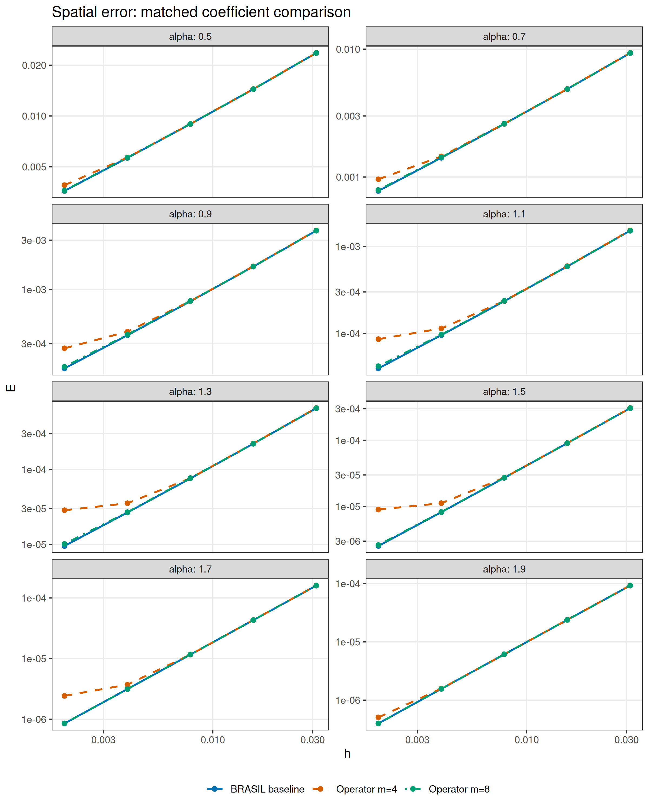
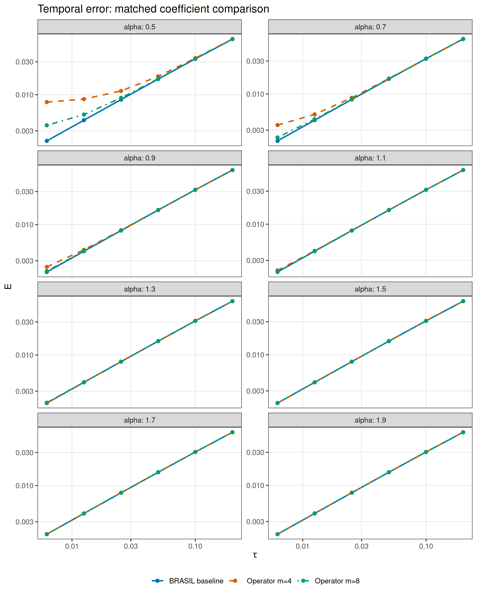

```{r setup, include=FALSE}
knitr::opts_chunk$set(echo=FALSE,message=FALSE,warning=FALSE,error=FALSE,cache=FALSE)
source("fun/rough/tau/load.R")
comparison <- readRDS("data_files/rough_comparison/comparison.rds")
floor_diagnostic <- jsonlite::fromJSON("data_files/rough_comparison/floor_diagnostic.json")
h4 <- comparison$h[comparison$h$order==4L,]
h8 <- comparison$h[comparison$h$order==8L,]
t4 <- comparison$tau[comparison$tau$order==4L,]
t8 <- comparison$tau[comparison$tau$order==8L,]
```

# Question and outcome

This branch, `rough/operator-based-coefficients`, tests whether the
operator-based root/factor approximation gives results similar to the
existing BRASIL rough-forcing experiments.

**The answer depends on the order and the experiment.**
Order eight gives spatial curves reasonably close to the saved BRASIL
curves: the finest-mesh error ratios range from
`r sprintf("%.4f",min(h8$finest_error_ratio))` to
`r sprintf("%.4f",max(h8$finest_error_ratio))`, and the largest difference
in corrected spatial slope is
`r sprintf("%.4f",max(abs(h8$operator_corrected-h8$brasil_corrected)))`.
Order four changes the spatial results substantially.

For temporal convergence, order eight is close to the BRASIL baseline at
the larger alpha values, but it does **not** reproduce the small-alpha
fine-step rates. At $\alpha=0.5$, the temporal slope is
`r sprintf("%.4f",t8$operator_slope[1])` instead of
`r sprintf("%.4f",t8$brasil_slope[1])`. The independent error decomposition
identifies a rational approximation floor. This is a numerical outcome,
not an assumption that all coefficient families should give the same rate
at fixed degree.

# Coefficients and controlled settings

## Direct rows, without interpolation

The active coefficient source is
`matlab/computed_fractional_roots.csv`, with the generation record in
`matlab/computed_fractional_roots.json`. It contains coefficients generated
directly at every requested $\beta=\alpha/2$, including orders one through
eight. No interpolation or nearest-row substitution is used.

These are locally generated Cheb–Padé coefficients in the operator-based
root/factor representation. They are distinct from the installed
`rSPDE:::m4table` rows, whose exponent grid generally does not contain
the requested values exactly. They are also distinct from the BRASIL
residue tables.

For $X=L_h/\kappa^2$, their scalar inverse approximation is
$$
R_m(x)=\mathrm{factor}\,
\frac{\prod_{i=1}^m(1-\mathrm{rc}_i x)}
{\prod_{i=1}^{m+1}(1-\mathrm{rb}_i x)}
\approx x^{-\beta}.
$$
The code converts this same rational function to partial fractions, then
forms the backward Euler function
$$
H_m(x)=\frac{R_m(x)}{R_m(x)+\tau\nu\kappa^\alpha}.
$$
The inverse and evolution functions are proper. There are $m+1$ shifted
solves and no constant mass-solve term. This algebraic conversion changes
the representation, not the coefficient family or its degree.

The branch's spatial and temporal results notebooks display order eight.
Order four is also run in full here to compare the order used in the
original smooth-data matrix notebooks.

## What remains identical

The comparison checks that the physical parameters and refinement grids
match the saved BRASIL results. It retains:

- The fixed infinite forcing $\sum_{j\geq1}\phi_j/j$ and zero initial data.
- The metric graph, $\kappa=4$, and $T=1$.
- Every spatial mesh and every actual temporal refinement grid.
- Diffusion equal to one for the spatial study.
- The original temporal diffusion
  $\nu_\alpha=(\kappa^2+4\pi^2)^{-\alpha/2}$ and alpha-specific meshes.
- Consistent P1 matrices, the exact nodal symmetry reduction, and every
  backward Euler time step.
- The full continuum error, including the infinite unresolved tail and
  the same stable time-moment and spatial-residual evaluation.

Only the rational family and degree change. The BRASIL baseline uses
order 14 spatially and orders 20/14 temporally; its original files and
helper sources are preserved under `data_files/rough_comparison/`.
No comparison curve is obtained by changing the forcing, diffusion, or
mesh to improve its fitted slope.

# Spatial comparison

The following slopes use exactly the original fit meshes
$h=1/128,1/256,1/512$. The correction is $J E_h$, with $J=\log_2(1/h)$.

```{r spatial-slopes}
knitr::kable(data.frame(alpha=h8$alpha,
  BRASIL=h8$brasil_corrected,operator_m4=h4$operator_corrected,
  operator_m8=h8$operator_corrected,
  finest_ratio_m4=h4$finest_error_ratio,finest_ratio_m8=h8$finest_error_ratio),
  digits=4,col.names=c("alpha","BRASIL corrected","m=4 corrected","m=8 corrected",
                       "Finest E4 / BRASIL","Finest E8 / BRASIL"))
```

```{r spatial-figure, out.width="800px", fig.cap="Matched full spatial errors. Each panel keeps the original physical and discretization parameters; only the coefficient family and degree differ."}

```

The order-eight spatial errors are close in level and have similar slopes,
but their rational contribution is not negligible in every case. Similarity
of total error norms does not by itself prove similarity of the underlying
error vectors.

# Temporal comparison

These slopes use the same three finest time steps,
$\tau=1/40,1/80,1/160$.

```{r temporal-slopes}
knitr::kable(data.frame(alpha=t8$alpha,
  BRASIL=t8$brasil_slope,operator_m4=t4$operator_slope,
  operator_m8=t8$operator_slope,
  finest_ratio_m4=t4$finest_error_ratio,finest_ratio_m8=t8$finest_error_ratio),
  digits=4,col.names=c("alpha","BRASIL slope","m=4 slope","m=8 slope",
                       "Finest E4 / BRASIL","Finest E8 / BRASIL"))
```

```{r temporal-figure, out.width="800px", fig.cap="Matched full temporal errors. A flattening at the fine steps indicates an auxiliary error floor rather than first-order temporal convergence over that interval."}

```

Order eight recovers slopes near one for $\alpha\geq1.1$ on this grid.
The smaller-alpha curves retain substantial rational error. Order four
has a larger floor and more strongly reduced fine-step slopes.

# Independent error-floor diagnosis

The checks use a 55-digit spectral oracle which evaluates the original
root/factor product directly. It does not reuse the production code's
partial-fraction conversion and does not generate the numerical FEM
solutions.

The rational error below is the norm of the difference between the exact
fractional FEM backward Euler solution and the root/factor FEM backward
Euler solution. It is compared with either the ideal spatial error or the
pure continuum backward Euler temporal error.

```{r error-components}
d <- comparison$oracle
finest_h <- d[d$study=="h" & d$J==max(comparison$baseline_h$parameters$J),]
finest_t <- d[d$study=="tau" & d$N==max(comparison$baseline_tau$parameters$N),]
h4d <- finest_h[finest_h$order==4L,]
h8d <- finest_h[finest_h$order==8L,]
t4d <- finest_t[finest_t$order==4L,]
t8d <- finest_t[finest_t$order==8L,]
knitr::kable(data.frame(alpha=h8d$alpha,
  h_m4=h4d$rational_to_spatial,h_m8=h8d$rational_to_spatial,
  tau_m4=t4d$rational_to_temporal,tau_m8=t8d$rational_to_temporal),
  digits=4,col.names=c("alpha","Spatial: rat4 / spatial","Spatial: rat8 / spatial",
    "Temporal: rat4 / temporal","Temporal: rat8 / temporal"))
```

A ratio larger than one means that the rational solution error exceeds
the error being isolated. Ratios do not add directly to produce the total
norm, since error components need not be orthogonal.

For example, at $\alpha=0.5$ and $\tau=1/160$, the order-eight rational
error is about
`r sprintf("%.3f",t8d$rational_to_temporal[1])`
times the pure temporal error. This explains the reduced observed slope.
The same forcing tail and FEM matrices were retained throughout.

## Extra time refinements at the smallest alpha

Two additional matrix runs at $\alpha=0.5$, $m=8$, with $N=320,640$
confirm the flattening beyond the original grid. They are diagnostic runs
and are not included in the fitted slopes or matched comparison curves.

```{r floor-probes}
knitr::kable(floor_diagnostic$probes,digits=c(0,8,8,8,8),
  col.names=c("N","Matrix error","Independent error","Relative discrepancy",
              "Pure temporal error"))
```

The independently calculated continuous-time limit of this fixed
spatial/rational approximation has error
`r sprintf("%.8f",floor_diagnostic$continuous_time_floor)`.
Decreasing $\tau$ approaches this nonzero floor; it does not remove it.

## Why a directly computed row can still be inaccurate on a fine mesh

Direct computation at $\beta$ removes interpolation error. It does not
make a finite-degree rational approximation exact over the whole discrete
spectrum.

The local generation record uses the function $z^{\beta-1}$ on
$[\delta_m,1]$, where
$$
\delta_m=10^{-(5+m)/2}.
$$
If $P_m/Q_{m+1}$ approximates that function, the inverse representation is
$$
R_m(X)=X^{-1}\frac{P_m(X^{-1})}{Q_{m+1}(X^{-1})}.
$$
Thus the generation interval corresponds to
$1\leq X\leq1/\delta_m$.
There is no stated accuracy guarantee outside this interval, and finite-degree
errors remain possible within it.

The temporal experiment needs especially fine meshes at small $\alpha$.
For its highest retained forced mode, the discrete eigenvalue gives
$$
z_{\min}=\frac{\kappa^2}{\kappa^2+3/h^2}.
$$

```{r interval-comparison}
p <- comparison$baseline_tau$parameters
zmin <- p$kappa^2/(p$kappa^2+3/(2^-p$J)^2)
knitr::kable(data.frame(alpha=p$alpha,J=p$J,
  smallest_active_z=formatC(zmin,format="e",digits=3),
  delta_m4=formatC(10^(-(5+4)/2),format="e",digits=3),
  delta_m8=formatC(10^(-(5+8)/2),format="e",digits=3)),
  col.names=c("alpha","J","Smallest active z","Generation delta, m=4","Generation delta, m=8"))
```

This interval comparison helps explain why the small-alpha temporal cases
are difficult for these fixed operator approximants. The measured error
decomposition, rather than the interval alone, establishes the size of
the rational floor.

## Why the original smooth-data tests can work at order four

The original matrix notebooks use only two spatial eigenfunctions. Their
solutions test the rational function at a few relatively low frequencies.
The rough forcing has a nonzero coefficient at every dyadic frequency.
Its solution coefficients decay like $2^{-\alpha j}/j$ at high frequency,
so smaller $\alpha$ makes accurate treatment of many high modes important.
The fine meshes needed in that range also expose a much wider discrete
spectrum to the rational approximation.

For any fixed order in this root/factor representation,
$R_m(X)\sim C_m/X$ as $X\to\infty$, whereas the exact inverse behaves as
$X^{-\beta}$. For $\beta<1$,
$$
\frac{R_m(X)}{X^{-\beta}}\sim C_m X^{\beta-1}\longrightarrow0.
$$
Thus sufficiently high modes are damped too strongly. Directly computed
rows eliminate beta-interpolation error, but not this finite-order
spectral approximation issue. Higher order extends the useful range; it
does not give a global relative-accuracy guarantee for arbitrary meshes.

# Validation and reproduction

All 176 new matrix errors (40 spatial and 48 temporal cases at each of
two orders) were checked against the independent direct-product oracle.
The maximum relative norm discrepancy was
`r format(max(comparison$oracle$relative_difference),scientific=TRUE,digits=4)`.

The automated test
[test_rough_operator_coefficients.R](../test/test_rough_operator_coefficients.R)
checks direct coefficient extraction for all available orders, rejection
of unavailable beta rows, positivity of the converted poles and residues,
agreement with the original polynomial matrix update supplied with the
same roots, and lifted full/reduced FEM iterate agreement.

The main scripts are recorded in
`/home/rierasl/Desktop/DOCS/NAP/rough_operator_comparison/`.
The source coefficients are fingerprinted in the experiment checkpoints.
The main notebooks are [spatial](conv_in_h_rough.html) and
[temporal](conv_in_tau_rough.html). Their saved results on this branch use
the directly computed operator coefficients at order eight.

The comparison supports a qualified conclusion: **order eight gives
similar spatial curves, but the present directly computed operator
coefficients do not recover all of the BRASIL temporal rates on the
original fine-step grids.** Higher accuracy over the relevant spectrum,
or a separately designed refinement range, would be required to remove
those remaining rational floors.

